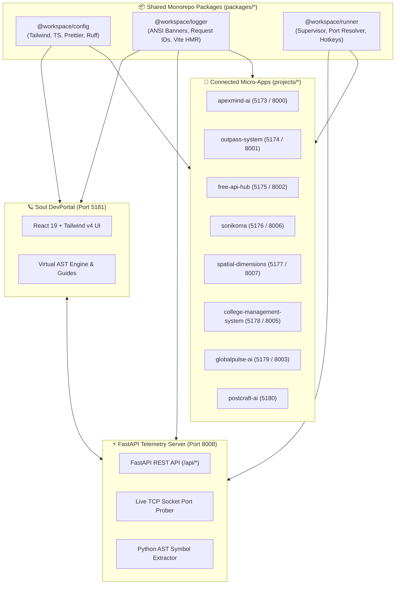

# 🪐 Soul Workspace — Developer Portal & Shared Packages Hub

<div align="center">

[](https://www.typescriptlang.org/)
[](https://www.python.org/)
[](https://react.dev/)
[](https://vitejs.dev/)
[](https://fastapi.tiangolo.com/)
[](https://tailwindcss.com/)
[](https://opensource.org/licenses/MIT)

<p align="center">
  <b>Central developer portal, polyglot package manager, real-time AST inspector, and multi-process supervisor for the Soul Workspace monorepo.</b>
</p>

</div>

---

## 📑 Table of Contents

- [Overview](#-overview)
- [System Architecture](#-system-architecture)
- [Shared Packages Catalog](#-shared-packages-catalog)
- [Monorepo Projects & Dedicated Ports](#-monorepo-projects--dedicated-ports)
- [Quick Start](#-quick-start)
  - [1. Launching the Web Portal](#1-launching-the-web-portal)
  - [2. Launching the FastAPI AST Backend](#2-launching-the-fastapi-ast-backend)
  - [3. Running the Extraction Pipeline](#3-running-the-extraction-pipeline)
  - [4. Installing Polyglot Packages](#4-installing-polyglot-packages)
- [Interactive Process Supervisor Hotkeys](#-interactive-process-supervisor-hotkeys)
- [Core Architecture Guides](#-core-architecture-guides)
- [Workspace Directory Structure](#-workspace-directory-structure)
- [Engineering Standards & Conventions](#-engineering-standards--conventions)

---

## 🌟 Overview

The **Soul DevPortal** serves as the unified engineering command center for the entire workspace. It provides:
1. **Interactive Documentation & Component Catalog**: Real-time markdown rendering and AST symbol extraction for all shared npm and Python packages.
2. **Polyglot Monorepo Core**: Seamless cross-language sharing between TypeScript (browser/Node) and Python (FastAPI/asyncio).
3. **Dedicated Port Protection**: 8 distinct applications engineered to run concurrently without port collisions or orphaned processes.
4. **Zero-Overhead Supervision**: Sandboxed process management with active socket probing and non-blocking terminal hotkeys.

---

## 🏗️ System Architecture



---

## 📦 Shared Packages Catalog

The `packages/` directory hosts core reusable utilities and configuration presets consumed across all frontend and backend services:

| Package | npm Manifest | Python Distribution | Module Name | Primary Responsibilities | Documentation |
| :--- | :--- | :--- | :--- | :--- | :--- |
| **`config`** | `@workspace/config` | — | — | Standardized TypeScript presets, Tailwind tokens, Prettier, ESLint, and Ruff configurations | [Config README](./packages/config/README.md) |
| **`logger`** | `@workspace/logger` | `workspace-logger` | `workspace_logger` | 5-column ANSI terminal formatting, sensitive credential masking, FastAPI middleware, client Vite bridge | [Logger README](./packages/logger/README.md) |
| **`runner`** | `@workspace/runner` | `workspace-runner` | `workspace_runner` | Dynamic app discovery, port conflict resolution (`--kill-port`), kernel sandboxing, interactive hotkeys | [Runner README](./packages/runner/README.md) |

---

## 🌐 Monorepo Projects & Dedicated Ports

All 8 workspace projects have **strictly assigned, non-overlapping ports** to enable seamless concurrent execution:

| Project | Frontend Port | Backend Port | Frontend Stack | Backend Stack | Database / Storage | Status |
| :--- | :---: | :---: | :--- | :--- | :--- | :---: |
| **`apexmind-ai`** | **`5173`** | **`8000`** | React 19 + Vite 8 + Tailwind v4 | Python FastAPI + Uvicorn | Local Media Store | Active |
| **`outpass-system`** | **`5174`** | **`8001`** | React 18 + Vite + Capacitor 8 | Python FastAPI + Uvicorn | SQLite + SQLAlchemy | Active |
| **`free-api-hub`** | **`5175`** | **`8002`** | React 18 + Vite + Tailwind CSS | Python FastAPI + Uvicorn | JSON Flat Store | Active |
| **`sonikoma`** | **`5176`** | **`8006`** | React 19 + Vite 8 + Tailwind v4 | Python FastAPI + Uvicorn | SQLite / Supabase PostgreSQL | Active |
| **`spatial-dimensions`** | **`5177`** | **`8007`** | React 19 + Vite 6 + Motion | Node.js Express (ESM) | JSONL Inquiry Store | Active |
| **`college-management-system`** | **`5178`** | **`8005`** | React 19 + Vite 6 + Tailwind v4 | Node.js Express (TypeScript) | SQLite (`better-sqlite3`) | Active |
| **`globalpulse-ai`** | **`5179`** | **`8003`** | Next.js 14 + React 18 | Python FastAPI + Uvicorn | SQLite / aiosqlite | Active |
| **`postcraft-ai`** | **`5180`** | — | Next.js 14 App Router | Fullstack Serverless Actions | SQLite Database | Active |

> [!TIP]
> For complete architecture details on inter-service proxies, databases, and deployment configurations, consult the [Port & Framework Architecture Guide](./PROJECTS_PORT_AND_FRAMEWORK_GUIDE.md).

---

## 🚀 Core Monorepo Commands Reference

The root `package.json` provides 5 canonical command contracts governing fullstack development, build orchestration, static verification, and micro-app supervision:

| Command | Action | Implementation | Scope / Runtime |
| :--- | :--- | :--- | :--- |
| **`npm run dev`** | Starts interactive DevPortal development server | `vite` | DevPortal Frontend (:5173) |
| **`npm run build`** | Builds production distribution assets with minification | `vite build` | Production Assets (`dist/`) |
| **`npm run typecheck`** | Validates TypeScript static types across codebase | `tsc --noEmit` | Static Type Analysis Engine |
| **`npm run dev:client`** | Concurrently boots client frontends with port-conflict guards | `python runner/bin/run-frontend.py` | Client Ecosystem (:5173–:5181) |
| **`npm run dev:server`** | Concurrently boots backend APIs with port-conflict guards | `python runner/bin/run-backend.py` | Server Ecosystem (:8000–:8008) |

### Additional Platform Scripts
- **`npm run dev:all`**: Concurrently boots all 8 applications (clients + servers) via `@workspace/runner`.
- **`npm run dev:portal:server`**: Starts the DevPortal telemetry and AST inspection FastAPI server on port `:8008`.
- **`npm run extract`**: Re-indexes all packages and AST symbols without running a server.
- **`npm run install:packages`**: Installs both npm workspaces and Python editable distributions.

---

## ⚡ Quick Start

---

## ⌨️ Interactive Process Supervisor Hotkeys

When launching services with `@workspace/runner`, the terminal supervisor listens for interactive single-key commands in real-time:

```text
 [r] Restart BE   [f] Restart FE   [a] Reload All   [o] Open UI   [b] API Docs
 [c] Clear        [p] Stats        [e] Env Info     [h] Help      [q] Quit
────────────────────────────────────────────────────────────────────────────────
```

| Key | Action | Behavior |
| :---: | :--- | :--- |
| **`r`** | **Restart Backend** | Terminate backend process group, free port, respawn, and await TCP probe |
| **`f`** | **Restart Frontend** | Cleanly restart Vite or Next.js dev server |
| **`a`** | **Reload All** | Fullstack restart in dependency order (Backend ➔ Healthcheck ➔ Frontend) |
| **`o`** | **Open UI** | Open client application URL in default web browser |
| **`b`** | **Open API Docs** | Open FastAPI Swagger UI (`/docs`) in default web browser |
| **`c`** | **Clear & Redraw** | Clear console scrollback and redraw banner |
| **`p`** | **Process Stats** | Display active PIDs, port bindings, memory RSS, and uptimes |
| **`e`** | **Env Summary** | Display loaded cascading `.env` hierarchy with redacted secrets |
| **`h`** | **Help** | Toggle interactive hotkey reference modal |
| **`q`** | **Quit** | Clean shutdown of all child processes via kernel sandboxing |

---

## 📚 Core Architecture Guides

Comprehensive documentation files included in this repository:

- 📜 **[Monorepo Projects Rules & Standards Guide](./Soul-DevPortal-Docs/PROJECTS_RULES_AND_STANDARDS_GUIDE.md)**: Authoritative golden rulebook governing all 8 micro-apps, directory conventions, and security.
- 📋 **[Monorepo Compliance Cheatsheet](./Soul-DevPortal-Docs/MONOREPO_COMPLIANCE_CHEATSHEET.md)**: Quick-reference operational checklists, top 10 rules, and supervisor CLI commands.
- 📘 **[Shared Packages Design & Creation Guide](./Soul-DevPortal-Docs/PACKAGES_DESIGN_GUIDE.md)**: Rules, schemas, and best practices for creating and maintaining shared libraries.
- 🌐 **[Port & Framework Architecture Guide](./Soul-DevPortal-Docs/PROJECTS_PORT_AND_FRAMEWORK_GUIDE.md)**: Network architecture, proxy routing, database engines, and dedicated ports.
- 📐 **[Tech Stack & Languages Architecture Guide](./Soul-DevPortal-Docs/TECH_STACK.md)**: Polyglot monorepo standards, compiler configurations, and ecosystem specifications.
- ⚡ **[Backend API Server & AST Parser Engine](./backend/README.md)**: FastAPI implementation, AST extractors, and live socket probes.
- ⚙️ **[Config Presets Specification](./Soul-DevPortal-Packages/config/README.md)**: TypeScript, Tailwind, Prettier, ESLint, and Ruff presets.
- 🪵 **[Logger Package Reference](./Soul-DevPortal-Packages/logger/README.md)**: Universal logging, request tracing, and terminal presentation.
- 🏃 **[Runner Supervisor Manual](./Soul-DevPortal-Packages/runner/README.md)**: Process management, cascading environments, and port resolution.

---

## 📁 Workspace Directory Structure

```text
Soul-DevPortal/
├── .gitignore                                 # Git ignore patterns
├── README.md                                  # Monorepo developer portal guide
├── PROJECT_RULES.md                           # Monorepo standards quick index
├── package.json                               # Monorepo workspaces manifest
├── tsconfig.json                              # TypeScript path aliases
├── vite.config.js                             # Vite bundler & virtual AST engine
├── index.html                                 # Web portal root document
├── projects.json                              # Central project registry & ports
│
├── Soul-DevPortal-Docs/                       # Authoritative Monorepo Architecture Docs
│   ├── PROJECTS_RULES_AND_STANDARDS_GUIDE.md  # Master Golden Rulebook
│   ├── MONOREPO_COMPLIANCE_CHEATSHEET.md      # Operational Cheatsheet & Top 10 Rules
│   ├── PROJECTS_PORT_AND_FRAMEWORK_GUIDE.md   # Port matrix & network topology
│   ├── TECH_STACK.md                          # Languages, runtimes & compiler presets
│   └── PACKAGES_DESIGN_GUIDE.md               # Shared packages design guide
│
├── Soul-DevPortal-Packages/                   # Monorepo Shared Core Libraries
│   ├── logger/                                # Universal 5-column logger & DevTools
│   ├── runner/                                # Multi-process supervisor & port manager
│   └── config/                                # Central design tokens & tool presets
│
├── Soul-DevPortal-Projects/                   # 8 Distinct Monorepo Micro-Applications
│   ├── apexmind-ai/                           # React 19 + FastAPI (5173 / 8000)
│   ├── outpass-system/                        # React 18 + FastAPI (5174 / 8001)
│   ├── free-api-hub/                          # React 18 + FastAPI (5175 / 8002)
│   ├── sonikoma/                              # React 19 + FastAPI (5176 / 8006)
│   ├── spatial-dimensions/                    # React 19 + Express (5177 / 8007)
│   ├── college-management-system/             # React 19 + Express (5178 / 8005)
│   ├── globalpulse-ai/                        # Next.js 14 + FastAPI (5179 / 8003)
│   └── postcraft-ai/                          # Next.js 14 Fullstack (5180)
├── projects.json                              # Central project registry & ports
│
├── backend/                                   # FastAPI Telemetry & AST Server (8008)
│   ├── main.py                                # Backend entrypoint & CLI launcher
│   ├── server.py                              # FastAPI app, CORS & middlewares
│   ├── api/                                   # Modular REST controllers
│   ├── core/                                  # Path resolvers & telemetry calculator
│   ├── extractors/                            # Python AST & TypeScript parsers
│   └── models/                                # Pydantic schemas
│
├── packages/                                  # Polyglot Shared Libraries
│   ├── config/                                # @workspace/config
│   │   ├── tsconfig/                          # Strict TypeScript presets
│   │   ├── tailwind/                          # Design tokens & preset
│   │   ├── prettier/                          # Formatter config
│   │   ├── eslint/                            # ESLint configurations
│   │   └── python/                            # Ruff & pytest configs
│   │
│   ├── logger/                                # @workspace/logger (workspace-logger)
│   │   ├── src/                               # TypeScript logger & Vite plugin
│   │   └── workspace_logger/                  # Python 5-column ANSI logger
│   │
│   └── runner/                                # @workspace/runner (workspace-runner)
│       ├── bin/                               # CLI entrypoints (run-dev.py, etc.)
│       └── workspace_runner/                  # Process supervisor & port resolver
│
├── projects/                                  # 8 Monorepo Applications
│   ├── apexmind-ai/                           # Port 5173 / 8000
│   ├── college-management-system/             # Port 5178 / 8005
│   ├── free-api-hub/                          # Port 5175 / 8002
│   ├── globalpulse-ai/                        # Port 5179 / 8003
│   ├── outpass-system/                        # Port 5174 / 8001
│   ├── postcraft-ai/                          # Port 5180
│   ├── sonikoma/                              # Port 5176 / 8006
│   └── spatial-dimensions/                    # Port 5177 / 8007
│
└── src/                                       # Developer Portal Frontend (Port 5181)
    ├── main.tsx                               # React 19 root application
    ├── styles.css                             # Tailwind CSS v4 styling
    ├── types.ts                               # TypeScript domain contracts
    └── components/                            # UI Views & Markdown renderer
```

---

## 🛡️ Engineering Standards & Conventions

1. **Package Naming**:
   - npm packages: `@workspace/<slug>`
   - Python distributions: `workspace-<slug>`
   - Python import modules: `workspace_<slug>`
2. **Deterministic Ports**: Never start services on unassigned or arbitrary ports; always consult [projects.json](./projects.json).
3. **Zero `sys.path` Hacks**: Python packages must be properly installed via `pip install -e` or linked through canonical distribution paths.
4. **Sandboxed Supervision**: Use `@workspace/runner` for starting development processes to prevent orphaned background tasks.
5. **Masking Sensitive Data**: All log output containing authorization tokens, passwords, cookies, or secrets must pass through `@workspace/logger` credential redaction.

---

<div align="center">
  <sub>Maintained for the Soul Workspace Ecosystem. Designed for stability, developer speed, and clean modularity.</sub>
</div>
