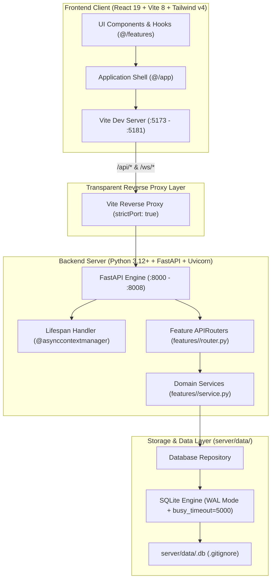

# Project Architecture — The Golden Architectural Invariants & Rules

> **Scope**: Monorepo Workspace Architectural Rules & Engineering Invariants  
> **Applies to**: All 9 micro-applications, shared packages, and developer portal components  
> **Status**: `MANDATORY WORKSPACE SPECIFICATION` · Zero-Drift Policy Enforced

---

## Architecture Topology Overview

The diagram below illustrates the mandatory Three-Pillar execution topology across all applications in the Soul Monorepo:



---

## Part I: The 10 Fundamental Architectural Pillars

> [!IMPORTANT]
> The 10 Architectural Pillars are absolute workspace invariants. Every PR, new micro-app, and refactoring must satisfy all 10 invariants before merging into `main`.

### 1. Unified Three-Pillar Standard

Every micro-application must strictly implement the canonical triad:

- **Client**: React 19 + Vite 8 + Tailwind CSS v4 on dedicated ports (`:5173` through `:5181`).
- **Server**: Python 3.12+ + FastAPI + Uvicorn on dedicated ports (`:8000` through `:8008`).
- **Persistence**: Embedded SQLite with Write-Ahead Logging (`WAL`) stored in `server/data/<app>.db`.

> [!NOTE]
> Ad-hoc introduction of external database containers (e.g., PostgreSQL, MongoDB) or alternative backend runtimes (Node Express, Go, Django) for local development without architectural signoff is strictly prohibited.

---

### 2. Strict Feature-Slice Co-Location (FSD)

All domain-specific UI components, custom React hooks, API fetchers, TypeScript types, and server endpoints must be co-located within dedicated feature slices under:

- `client/src/features/<feature-name>/` (Frontend)
- `server/features/<feature-name>/` (Backend)

Horizontal catch-all dumping grounds (e.g. `src/components/`, `src/hooks/`) are reserved strictly for generic, domain-agnostic primitives.

---

### 3. The Public Facade Barrier (`index.ts`)

Each client feature directory must maintain a single `index.ts` barrier file. Outside modules (such as `src/app/` or another feature) may **only** import from the feature's root `@/features/<feature-name>`, never from internal sub-paths.

```typescript
// ✅ Compliant: Import via public barrier
import { UserProfileCard, useUserProfile } from '@/features/profile';

// ❌ Prohibited: Deep-linking into feature internals
import { UserProfileCard } from '@/features/profile/components/UserProfileCard';
```

---

### 4. Decoupled Application Shell (`src/app/`)

The `src/app/` directory serves exclusively as the application bootstrap factory, router, layout frame, and global provider tree.

- It must contain **zero** business domain logic, raw database mutations, or domain calculation algorithms.
- It aggregates routes defined in features and renders global layout wrappers.

---

### 5. Mandatory Reverse Proxying via Vite

Client applications must **never** hardcode backend origins or ports (e.g., `http://localhost:8000/api`) in source code.

- All network calls must use relative paths (`/api/...` or `/ws/...`).
- The Vite dev server transparently proxies all `/api` and `/ws` traffic to the corresponding backend port with `strictPort: true`.

```typescript
// client/vite.config.ts
export default defineConfig({
  server: {
    port: 5173,
    strictPort: true, // Prevents silent port hopping
    proxy: {
      '/api': { target: 'http://127.0.0.1:8000', changeOrigin: true },
      '/ws': { target: 'ws://127.0.0.1:8000', ws: true },
    },
  },
});
```

---

### 6. Standardized JSON Response Envelopes

All API endpoints must return a predictable, typed envelope structure:

```json
{
  "success": true,
  "data": { ... },
  "error": null,
  "timestamp": "2026-11-24T12:00:00.000Z",
  "meta": {
    "version": "1.0.0",
    "requestId": "req_8f1b2c3d"
  }
}
```

> [!WARNING]
> Never return HTTP 200 OK with an error payload. Failures must return semantic HTTP status codes (`400`, `401`, `403`, `404`, `422`, `500`) with `"success": false` and `"error": "Descriptive message"`.

---

### 7. Isolated SQLite Persistence (`server/data/`)

All SQLite database files (`.db`, `.db-wal`, `.db-shm`) must reside strictly in `server/data/<app>.db` and be permanently excluded from version control via `.gitignore`.

- Every connection must enable Write-Ahead Logging (`PRAGMA journal_mode = WAL;`) and set `PRAGMA busy_timeout = 5000;`.
- The directory `server/data/` is preserved in Git using `.gitkeep`.

---

### 8. Canonical Manifest Parity (`metadata.json`)

Every project root must maintain an authoritative `metadata.json` declaring its title, ports, framework, server stack, database, and commands, exactly matching `projects.json`.

- Discrepancies between `metadata.json`, `projects.json`, and running ports cause immediate CI validation failure.

---

### 9. Zero-Secret-in-Git & Prefix Scoping

No `.env` or credential files may ever be committed to version control.

- All required environment variables must be documented with safe placeholder defaults in `.env.example`.
- Variables must follow strict prefix scoping:
  - `VITE_`: Frontend client variables exposed to browser bundles.
  - `SERVER_`: Backend host, port, worker runtime settings.
  - `DB_`: SQLite pathing and database options.
  - `AI_`: GenAI API keys (e.g., `AI_GEMINI_API_KEY`).
  - `AUTH_`: JWT secrets, session keys, and OAuth credentials.

---

### 10. Fail-Fast Boot Validation & Sanitized Logging

Backends must validate all required environment configurations on startup and terminate immediately if invalid.

- Sensitive values (API keys, bearer tokens, passwords) must **never** appear in plain text in terminal output or log files.
- Mask secrets using `@workspace/logger` or standard obfuscation (`sk-...xxxx`).

---

## Part II: Inviolable Domain Architectural Rules

### Section 1: Monorepo Directory & Layout Rules

> **Status**: `MANDATORY INVARIANT`  
> **Applies To**: All project directories in `Soul-DevPortal-Projects/`

---

## The 8 Inviolable Directory Layout Rules

### 1. Dual-Pillar Root Structure

Every project in `Soul-DevPortal-Projects/<app>/` must contain strictly:

- `client/`: React 19 + Vite 8 frontend application.
- `server/`: Python FastAPI + Uvicorn backend service.
- `metadata.json`: Machine-readable project manifest.
- `package.json`: Monorepo scripts (`dev`, `build`, `lint`).
- `README.md`: Project onboarding guide.
- `.env.example`: Safe environment baseline template.

> [!CAUTION]
> Loose root-level files (such as `test.js`, `temp.py`, `data.db`, `server.py`) outside their respective directories are strictly forbidden.

### 2. Path Aliasing Standard (`@/*`)

- Client code must map `@/*` directly to `src/*` in both `tsconfig.json` and `vite.config.ts`.
- Upward relative imports traversing more than two levels (e.g. `../../../components`) are strictly prohibited. Use `@/features/...` or `@/shared/...`.

### 3. Absolute Cross-Project Boundary Isolation

- A project in `Soul-DevPortal-Projects/<app-a>` may **never** import files from `Soul-DevPortal-Projects/<app-b>` via relative paths (`../../app-b/src`).
- Code sharing across microservices is allowed strictly through versioned packages in `Soul-DevPortal-Packages/` (e.g. `@workspace/logger`, `@workspace/config`, `@workspace/runner`).

### 4. Client Feature-Slice Co-location

- Domain code must be co-located in `client/src/features/<feature-name>/`.
- Each feature must contain its own `components/`, `api/`, `hooks/`, `types.ts`, and `index.ts`.

### 5. Decoupled Application Shell (`src/app/`)

- `client/src/app/` functions purely as the application factory, router, layout frame, and global provider tree.
- Zero domain business logic, data mutations, or direct fetch calls may exist in `src/app/`.

### 6. Public Static Asset Boundaries (`client/public/`)

- Uncompiled assets (SVGs, PNGs, favicons, fonts) must reside in `client/public/`.
- Every project must supply `client/public/logos/logo.svg` for DevPortal catalog rendering.

### 7. Server Feature Slice Standard

- Server features must reside in `server/features/<feature-name>/`, containing:
  - `router.py`: FastAPI endpoint declarations.
  - `service.py`: Business logic and external API communication.
  - `schemas.py`: Pydantic request and response models.
  - `__init__.py`: Public feature interface.

### 8. Persistence Isolation (`server/data/`)

- All runtime database files, caches, and uploaded assets must live strictly in `server/data/`.

---

### Section 2: Tech Stack & Framework Rules

> **Status**: `MANDATORY INVARIANT`  
> **Applies To**: Framework selection, compiler versions, and runtime technologies across all projects

---

## The 8 Inviolable Framework & Tech Stack Rules

### 1. Mandatory Three-Pillar Standard

Every project in `Soul-DevPortal-Projects/` must strictly adopt the three canonical pillars:

1. **Frontend Client**: React 19 + TypeScript 5.8+ + Vite 8 + Tailwind CSS v4.
2. **Backend Server**: Python 3.12+ + FastAPI + Uvicorn.
3. **Persistence Layer**: Embedded SQLite with Write-Ahead Logging (WAL).

### 2. React 19 Frontend Invariants

- Consume React 19 features natively (`useActionState`, `useOptimistic`, `use`, `<Suspense>`).
- Code must be strictly compatible with the React Compiler (pure render functions, zero mutable side effects during render).
- Legacy React patterns (`componentWillMount`, class components, unsafe lifecycles) are forbidden.

### 3. Vite 8 Bundler Standard

- All frontend clients must use Vite 8 bundled with `@vitejs/plugin-react` and `@tailwindcss/vite`.
- `server.strictPort` must be set to `true` to ensure port predictability.

### 4. Pure CSS-First Tailwind CSS v4

- Styling must be powered natively by `@tailwindcss/vite`.
- Legacy `tailwind.config.js`, `tailwind.config.ts`, and `postcss.config.js` are prohibited.
- Import Tailwind via `@import "tailwindcss";` in `src/index.css`. Theme variables must be declared in `@theme`.

### 5. Python 3.12+ Backend Standard

- Backends must run on Python 3.12 or newer.
- Standards:
  - Web Framework: **FastAPI** (current stable release).
  - ASGI Server: **Uvicorn** with standard worker loop.
  - Data Validation: **Pydantic v2** (`BaseModel`, `Field`).
  - Configuration: `pydantic-settings` (`BaseSettings`).

### 6. TypeScript Strict Mode

- `tsconfig.json` must enforce `"strict": true`, `"noImplicitAny": true`, `"strictNullChecks": true`, and `"skipLibCheck": true`.
- Explicit or implicit `any` is forbidden in production code. Use `unknown` with narrowing or Zod parsing.

### 7. AI Engine Integrations (Gemini Standard)

- Microservices featuring AI generative capabilities must use Google Gemini (`google-genai` Python SDK or `@google/genai` TypeScript SDK).
- Model Standard: Default to `gemini-2.5-flash` for high-speed streaming and JSON structuring.

### 8. Tooling & Formatting Uniformity

- Linting and formatting must follow ESLint / Prettier standards on the frontend, and Ruff / Black / Pyright on Python backends.

---

### Section 3: Client Application Rules

> **Status**: `MANDATORY INVARIANT`  
> **Applies To**: All React 19 + Vite 8 + Tailwind CSS v4 frontend applications

---

## The 8 Inviolable Client Rules

### 1. Unified Tech Stack: React 19 + Vite 8 + Tailwind v4

- All frontend clients must run on React 19, bundled using Vite 8, and styled with Tailwind CSS v4.
- Client ports are strictly reserved between `5173` and `5181` (per `projects.json`).

### 2. Mandatory Reverse Proxying via Vite

- Client code must **never** hardcode backend origins or ports (e.g. `http://localhost:8000/api`).
- All network requests must use relative paths (`/api/...`). The client Vite dev server must proxy `/api` and `/ws` to the corresponding backend port with `strictPort: true`.

### 3. Pure CSS-First Tailwind v4

- Do not create legacy JavaScript configuration files (`tailwind.config.js`).
- Declare theme tokens using CSS custom properties under `@theme`:

```css
@import "tailwindcss";

@theme {
  --color-obsidian-900: #070709;
  --color-obsidian-800: #111115;
  --color-obsidian-700: #16161c;
  --color-accent-purple: #a855f7;
  --font-mono: 'JetBrains Mono', monospace;
}
```

### 4. Modern React 19 Primitives

- Use modern React 19 asynchronous primitives (`useActionState`, `useOptimistic`, `use`, `<Suspense>`).
- Deprecated React lifecycle methods and unsafe side-effects during render are strictly forbidden. Components must be pure functions.

### 5. Path Aliasing Enforcement (`@/*`)

- All project imports must consume the `@/*` alias mapped to `./src/*`.
- Never use upward traversing relative paths beyond 1 level (`../../..`).

### 6. Decoupled Application Factory (`src/app/`)

- `src/app/` serves as the router, provider tree, and layout shell.
- No business logic, raw API fetches, or feature-specific state management may be declared in `src/app/`.

### 7. Next.js Migration Shims

- When porting components originally written for Next.js, route through the standard shims (`next-link.tsx`, `next-navigation.ts`, `next-image.tsx`) located in `src/shared/lib/` or `@workspace/config` to guarantee zero build failures.

### 8. Zero Unhandled Promise Rejections & Console Errors

- Client builds must pass with zero TypeScript errors (`tsc --noEmit`). Runtime executions must be free of unhandled Promise rejections and uncaught React exceptions in the browser console.

---

### Section 4: Server & Runtime Rules

> **Status**: `MANDATORY INVARIANT`  
> **Applies To**: All Python FastAPI + Uvicorn server implementations in `Soul-DevPortal-Projects/`

---

## The 8 Inviolable Server Rules

### 1. Mandatory Python FastAPI + Uvicorn Runtime

- All backend microservices must be built with Python 3.12+ using FastAPI and served via Uvicorn.
- Server ports are strictly pinned between `8000` and `8008` (matching `projects.json`).

### 2. Lifespan Handler over Deprecated Startup Events

- Application lifecycle events must be managed using the ASGI `@asynccontextmanager` `lifespan` handler.
- Deprecated `@app.on_event("startup")` and `@app.on_event("shutdown")` are strictly forbidden.

```python
# server/app/lifespan.py
from contextlib import asynccontextmanager
from fastapi import FastAPI
from database.connection import get_db_connection

@asynccontextmanager
async def lifespan(app: FastAPI):
    # Startup: Run schema migrations and connection warmup
    with get_db_connection() as conn:
        conn.execute("PRAGMA optimize;")
    yield
    # Shutdown: Cleanly flush write-ahead log
    with get_db_connection() as conn:
        conn.execute("PRAGMA wal_checkpoint(TRUNCATE);")
```

### 3. Strict CORS Whitelisting

- CORS middleware must explicitly whitelist only authorized local client origins (e.g. `http://localhost:5173`, `http://127.0.0.1:5173`).
- `allow_origins=["*"]` is strictly forbidden when `allow_credentials=True`.

### 4. Zero Blocking Calls on the Event Loop

- The main async event loop must never be blocked by CPU-intensive calculations, synchronous file I/O, or blocking network calls.
- Wrap synchronous operations using `await asyncio.to_thread(blocking_function, *args)`.

### 5. Dependency Injection for Shared Resources

- Database connections, AI client instances (Gemini), and configuration objects must be supplied to route handlers using FastAPI's `Depends()` dependency injection mechanism.

### 6. Centralized Exception Handling Middleware

- The server must register global exception handlers for `RequestValidationError`, `HTTPException`, and uncaught `Exception`.
- Uncaught exceptions must return a standardized JSON error envelope with HTTP status 500 without leaking Python tracebacks to the client.

### 7. Structured Logging with `@workspace/logger`

- All request access logs and system diagnostic events must be formatted using `@workspace/logger` or standardized 5-column formats:
  `[TIMESTAMP] [LEVEL] [SERVICE] [TRACE_ID] MESSAGE`
- Sensitive tokens, passwords, and PII must be automatically masked before output.

### 8. Graceful Shutdown & Process Cleanup

- Servers must intercept `SIGINT` and `SIGTERM` signals, drain in-flight requests within a 5-second grace period, close SQLite WAL handles, and exit cleanly with code `0`.

---

### Section 5: API & Routing Rules

> **Status**: `MANDATORY INVARIANT`  
> **Applies To**: All FastAPI backend services in `Soul-DevPortal-Projects/`

---

## The 8 Inviolable API Rules

### 1. Mandatory Prefixing (`/api` or `/api/v1`)

- Every HTTP endpoint must be served under `/api` or `/api/v1`. Root-level endpoints like `/users` or `/items` are strictly prohibited.
- Enables transparent reverse proxying in Vite without conflicting with SPA client-side routes.

### 2. Standardized JSON Response Envelope

All successful and erroneous responses must adhere to the standard envelope format:

```json
{
  "success": true,
  "data": { ... },
  "error": null,
  "timestamp": "2026-11-24T12:00:00.000Z",
  "meta": {
    "version": "1.0.0",
    "requestId": "req_8f1b2c3d"
  }
}
```

### 3. Strict HTTP Status Code Semantics

- Never return HTTP 200 OK with an error payload.
- Standard semantics:
  - `200 OK`: Successful read or standard mutation.
  - `201 Created`: Successful creation of a new entity (returns entity in `data`).
  - `204 No Content`: Successful deletion or execution with no payload.
  - `400 Bad Request`: Business rule violation or domain rejection.
  - `401 Unauthorized`: Missing or invalid authentication token.
  - `403 Forbidden`: Authenticated user lacks permission.
  - `404 Not Found`: Target resource does not exist.
  - `422 Unprocessable Entity`: Schema validation failure (Pydantic / Zod).
  - `500 Internal Server Error`: Unhandled server exception.

### 4. Mandatory Health & Readiness Probes

- Every backend must implement `GET /api/health` and `GET /api/ready`.
- Health Contract:

```json
{
  "status": "healthy",
  "app": "apexmind-ai",
  "timestamp": "2026-11-24T12:00:00.000Z",
  "uptime_seconds": 1840,
  "db_connected": true
}
```

### 5. No Logic in `main.py`

- `main.py` is reserved exclusively for the application factory, lifespan management, middleware registration, and router aggregation.
- Zero endpoint route handlers (`@app.get()`, `@app.post()`) may be written inside `main.py`. All handlers must reside in feature routers under `features/<feature>/router.py`.

### 6. Pydantic v2 Request/Response Validation

- Every mutating endpoint (`POST`, `PUT`, `PATCH`) must validate incoming bodies with strict Pydantic v2 models. Every endpoint must declare a typed `response_model`.
- Untyped `dict` parameters (`data: dict = Body(...)`) are forbidden.

### 7. Explicit Async Handlers

- Every FastAPI route handler must be declared as `async def`.
- If performing synchronous blocking I/O, wrap it in `await asyncio.to_thread(...)`.

### 8. Structured Error Handling & Global Interceptor

- Application code must raise standard `HTTPException` or custom domain exceptions.
- The global exception interceptor must catch uncaught exceptions, log the stack trace using `@workspace/logger` with sensitive data masked, and return a clean 500 JSON envelope without leaking internal stack traces to the client.

---

### Section 6: Database & Persistence Rules

> **Status**: `MANDATORY INVARIANT`  
> **Applies To**: All persistence engines, SQLite databases, and repositories across the monorepo

---

## The 8 Inviolable Database Rules

### 1. SQLite WAL Mode is Mandatory

Every SQLite connection must execute the following PRAGMAs immediately upon opening:

```sql
PRAGMA journal_mode = WAL;
PRAGMA synchronous = NORMAL;
PRAGMA foreign_keys = ON;
PRAGMA busy_timeout = 5000;
```

> [!TIP]
> Write-Ahead Logging allows unlimited concurrent readers while write transactions execute, completely eliminating `database is locked` concurrency errors.

### 2. Isolated Storage in `server/data/`

- Database binary files must reside strictly inside `server/data/<project-name>.db`.
- Never place database files in `client/`, `src/`, or repository roots.
- Never share a single SQLite file across multiple project boundaries (each microservice has its own isolated file).

### 3. Strict Git Exclusion

- Database binary and journal files must be completely ignored in `.gitignore`:

```gitignore
server/data/*.db
server/data/*.db-shm
server/data/*.db-wal
server/data/*.sqlite
```

- The `server/data/` directory must be preserved in version control using a `.gitkeep` file.

### 4. Declarative Schemas in Source Control

- Every database table, index, and trigger must be declaratively defined in a versioned SQL file:
  `server/database/schema.sql`.

### 5. Foreign Key Integrity Enforced

- SQLite disables foreign key enforcement by default. Every connection factory must explicitly run `PRAGMA foreign_keys = ON;`. Deleting a parent row must adhere to defined `ON DELETE CASCADE` or `ON DELETE RESTRICT` constraints.

### 6. Busy Timeout & Connection Resilience

- All connection strings must set `busy_timeout = 5000` (5 seconds). If a write lock is held, callers automatically wait up to 5000ms instead of immediately throwing an operational error.

### 7. Explicit Transactions & Safe Rollbacks

- Mutating multiple records must always occur inside a managed transaction context (`BEGIN ... COMMIT`).
- In Python, use context managers:

```python
with conn:
    conn.execute("INSERT INTO items ...", (...))
    conn.execute("UPDATE stats ...", (...))
```

Any unhandled exception automatically triggers a complete `ROLLBACK`.

### 8. Atomic Backup Protocols

- Never copy a live SQLite file using raw file copy (`cp` or `copy`) while the server is running, as it risks corrupting WAL frames. Use SQLite's online backup API:
  `sqlite3 server/data/<app>.db ".backup server/data/<app>_backup.db"`

---

### Section 7: Schema & Manifest Invariants

> **Status**: `MANDATORY INVARIANT`  
> **Applies To**: `metadata.json`, Pydantic models, Zod schemas, and TypeScript interfaces

---

## The 8 Inviolable Schema Rules

### 1. Authoritative `metadata.json` Parity

- Every project root in `Soul-DevPortal-Projects/<app>/` must contain a schema-compliant `metadata.json`.
- The project `title`, `ports`, `techStack`, `commands`, and `apiEndpoints` in `metadata.json` must exactly match the implementation in `vite.config.ts`, `main.py`, and `projects.json`.

### 2. Strict Pydantic v2 Contract on Server

- Every FastAPI endpoint accepting an HTTP request payload or returning response data must declare a Pydantic v2 `BaseModel`.
- Generic dictionaries (`dict[str, Any]`), raw strings, or untyped tuples are strictly forbidden as route inputs or outputs.

### 3. Zod Schema Mirroring on Client

- Client-side forms, user inputs, and external API integrations must be validated using Zod schemas that mirror backend Pydantic models.
- Infer TypeScript types directly from Zod using `z.infer<typeof Schema>` to eliminate dual-definition drift.

### 4. Zero Implicit `any` Policy

- TypeScript files must be compiled under strict mode (`"strict": true` in `tsconfig.json`).
- Use of `any` is prohibited. If a type is dynamically structured, use `unknown` combined with type narrowing or Zod parsing.

### 5. Standardized Date & Time Representation

- All timestamps in schemas and database columns must use ISO-8601 UTC strings (`YYYY-MM-DDTHH:MM:SS.sssZ`).
- In Pydantic, use `Field(default_factory=lambda: datetime.now(timezone.utc).isoformat())`.

### 6. Unique Identifier Conventions

- Primary key IDs across schemas must use prefixed entity strings (e.g. `usr_12345`, `sess_67890`, `msg_abcde`) or standard UUIDv4 strings.

### 7. Non-Empty String Constraints

- String fields representing required entity attributes (e.g. `title`, `name`, `email`) must enforce `min_length=1` and `strip_whitespace=True` in Pydantic.

### 8. Schema Deprecation Protocol

- When changing schema fields, preserve backward compatibility. Mark deprecated fields with `deprecated: bool = True` or Pydantic `Field(..., deprecated=True)` before removal in a subsequent minor version.

---

### Section 8: Feature-Sliced Design (FSD) Rules

> **Status**: `MANDATORY INVARIANT`  
> **Applies To**: Feature-Sliced Design (FSD) implementation across Client and Server

---

## The 8 Inviolable Feature-Slice Rules

### 1. Strict Feature Domain Co-location

- All UI components, custom hooks, API calls, state stores, and TypeScript types specific to a single business capability must be grouped together under:
  - `client/src/features/<feature-name>/` (Frontend)
  - `server/features/<feature-name>/` (Backend)
- Creating horizontal catch-all directories is strictly forbidden.

### 2. The Public Facade Barrier (`index.ts`)

- Every client feature slice must expose a single `index.ts` entry point that exports only its approved public interface.
- Outside modules may **only** import from `@/features/<feature-name>`, never from internal private files.

### 3. Absolute Prohibition of Lateral Dependencies

- Feature A may never directly import private files or state from Feature B.
- If logic or UI must be shared between two features, extract the common capability to `src/shared/` or pass data through URL query parameters or application shell state.

### 4. Single-Responsibility Subdirectories

Each client feature folder must adhere to standard subdirectories:

- `api/`: API fetchers and mutations.
- `components/`: UI components belonging to the feature.
- `hooks/`: Custom React 19 hooks.
- `types.ts`: TypeScript interfaces and schemas.
- `index.ts`: The public export barrier.

### 5. Server Router-Service Separation

Server features (`server/features/<feature-name>/`) must strictly separate routing from business logic:

- `router.py`: Declares HTTP routes, status codes, and input validation.
- `service.py`: Executes business algorithms, external API calls, and domain rules.
- `schemas.py`: Pydantic input and output models.

> [!WARNING]
> Writing raw database queries or external API logic directly inside route handlers in `router.py` is forbidden.

### 6. Local State Containment

- State required only by a feature must remain local to that feature slice (via React `useState`, `useReducer`, or feature-scoped context).
- Global state is reserved strictly for cross-cutting session, authentication, and theme primitives.

### 7. Feature Documentation Parity

- Every feature directory must include a `README.md` documenting its capabilities, required API endpoints, and exported components.

### 8. Self-Contained Mocking & Testing

- Any mock data, test fixtures, or unit tests for a feature must live directly within that feature's directory (e.g. `features/<feature>/__tests__/`).

---

### Section 9: Environment & Security Invariants

> **Status**: `MANDATORY INVARIANT`  
> **Applies To**: All environment variables, secret management, and configuration across the monorepo

---

## The 8 Inviolable Environment & Security Rules

### 1. Absolute Zero-Secret-in-Git Policy

- Actual `.env`, `.env.local`, `.env.production`, and secret files must **never** be committed to version control.
- Verify `.gitignore` contains `.env*` with exception for `.env.example`.

### 2. Mandatory `.env.example` Baseline

- Every project root must provide a `.env.example` documenting every single environment variable required by both client and server.
- Placeholder values must be safe dummies (e.g. `your_gemini_api_key_here`, `secret_jwt_placeholder`).

### 3. Strict Prefix Scoping Matrix

| Prefix | Domain Scope | Security Rule |
| --- | --- | --- |
| `VITE_` | Client Browser Bundle | Publicly visible in compiled JS; **never** put secret API keys here |
| `SERVER_` | FastAPI / Uvicorn Server | Host, port, worker count, CORS origins |
| `DB_` | Persistence Engine | SQLite file paths, busy timeouts, WAL pragmas |
| `AI_` | GenAI Integrations | Gemini API keys, model parameters, temperature |
| `AUTH_` | Security & Sessions | JWT secrets, password salts, OAuth client secrets |

### 4. Fail-Fast Startup Validation

Backends must validate environment variables on boot (via Pydantic `BaseSettings`). If a required variable is missing or invalid, the process terminates immediately with exit code `1`:

```python
# server/shared/config.py
from pydantic_settings import BaseSettings
from pydantic import Field

class AppSettings(BaseSettings):
    server_port: int = Field(default=8000, alias="SERVER_PORT")
    db_path: str = Field(default="server/data/app.db", alias="DB_PATH")
    gemini_api_key: str = Field(..., alias="AI_GEMINI_API_KEY")

    class Config:
        env_file = ".env"
```

### 5. Sensitive Data Masking in Logs

- Passwords, API tokens, bearer keys, and database secrets must **never** appear in plain text in terminal output or log files.
- Mask secrets using `@workspace/logger` or the standard obfuscation pattern: show first 3 and last 4 characters (`sk-...xxxx`).

### 6. Zero Hardcoded Credentials in Source Code

- API keys, database paths, and secrets must never be hardcoded into `.py`, `.ts`, or `.tsx` files. Always read from environment variables.

### 7. Universal Default Fallbacks for Local Dev

- Non-secret configurations (e.g. `PORT=8000`, `LOG_LEVEL=INFO`, `SQLITE_DB_PATH=server/data/app.db`) must supply safe defaults in code so that applications can start out-of-the-box for local testing.

### 8. Master Baseline & Schema Parity

- Whenever an application introduces a new environment dependency, its corresponding entry in the project's root `.env.example` and the Master Configuration Matrix in `project-env/main.md` must be updated immediately.

---

### Section 10: Monorepo Scripts, Tooling & Orchestration Standards

> **Status**: `MANDATORY INVARIANT`  
> **Applies To**: Workspace CLI tools, package runner, and supervisor commands

---

## The 8 Inviolable Monorepo Tooling Rules

### 1. Orchestration via `@workspace/runner`

- Monorepo processes must be started and supervised via `@workspace/runner` or standardized `npm run dev:*` scripts.
- Launching ad-hoc commands without port checks is prohibited.

### 2. Strict Port Matrix (9 Micro-Apps + DevPortal)

| Project ID | Title | Frontend Port | Backend Port | Database File |
| --- | --- | --- | --- | --- |
| `apexmind-ai` | ApexMind Studio AI | `:5173` | `:8000` | `apexmind.db` |
| `outpass-system` | Outpass Management System | `:5174` | `:8001` | `outpass.db` |
| `free-api-hub` | Free API Hub | `:5175` | `:8002` | `free_api_hub.db` |
| `globalpulse-ai` | GlobalPulse AI | `:5179` | `:8003` | `globalpulse.db` |
| `postcraft-ai` | PostCraft AI | `:5180` | `:8004` | `postcraft.db` |
| `college-management-system` | College Management System | `:5178` | `:8005` | `college_management.db` |
| `sonikoma` | Sonikoma AI Studio | `:5176` | `:8006` | `sonikoma.db` |
| `spatial-dimensions` | Spatial Dimensions | `:5177` | `:8007` | `spatial_dimensions.db` |
| `devportal` | Soul Developer Portal | `:5181` | `:8008` | `workspace.db` |

### 3. Port Conflict Pre-Flight Verification

- The CLI runner must probe target TCP sockets prior to spawning child processes.
- If a port is occupied by a stale zombie process, the runner warns the user and offers automatic process cleanup.

### 4. Concurrent Client-Server Startup

- Each project's `npm run dev` script must launch both client and server concurrently using `@workspace/runner`:
  `npx @workspace/runner project <app-id>`

### 5. Uniform Exit Code Propagation

- Child processes terminating with an error must propagate non-zero exit codes to the supervisor to prevent silent background crashes.

### 6. Clean Cross-Platform Path Handling

- All scripts and configuration files must use `path.join()`, `path.resolve()`, or `Path` from Python's `pathlib` to guarantee 100% interoperability across Windows, macOS, and Linux.

### 7. Shared Package Consumption Standard

- Every micro-application must consume `@workspace/logger` for structured logging, `@workspace/config` for baseline configurations, and `@workspace/runner` for process execution.

### 8. Continuous Compliance Gate

- PRs must pass `npm run build` across the DevPortal and all affected micro-applications before landing on `main`. Zero build warnings or type errors are tolerated.
