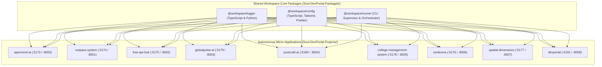
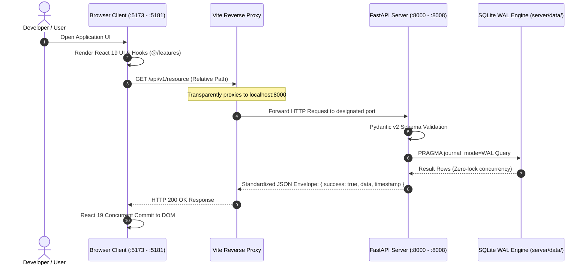

# Project Architecture — Master Technical Blueprint & Guide

> **Scope**: Enterprise Monorepo Architecture & Engineering Runbooks  
> **Applies to**: All micro-applications, shared packages, and developer portal components

---

---

## 1. Monorepo Structural Blueprint & Directory Layout

> **Domain**: Monorepo Topology, Directory Hierarchy & Module Scoping  
> **Applies to**: All micro-applications and shared packages across the workspace

---

## 1. Monorepo Structural Blueprint

The Soul Monorepo organizes all assets into three clear top-level domains:

- **`Soul-DevPortal-Packages/`**: Shared core libraries consumed by projects (`@workspace/logger`, `@workspace/runner`, `@workspace/config`).
- **`Soul-DevPortal-Projects/`**: Autonomous micro-applications adhering to the Three-Pillar standard.
- **`Soul-DevPortal-Docs/`**: The central engineering knowledge base and architectural standards portal.

```
                              SOUL MONOREPO ROOT
 ┌─────────────────────────────────────────────────────────────────────────────┐
 │                                                                             │
 │  ├── Soul-DevPortal-Packages/                                               │
 │  │   ├── workspace-config/   (@workspace/config)                            │
 │  │   ├── workspace-logger/   (@workspace/logger)                            │
 │  │   └── workspace-runner/   (@workspace/runner)                            │
 │  │                                                                          │
 │  ├── Soul-DevPortal-Projects/                                               │
 │  │   ├── apexmind-ai/                 (:5173 / :8000)                       │
 │  │   ├── outpass-system/              (:5174 / :8001)                       │
 │  │   ├── free-api-hub/                (:5175 / :8002)                       │
 │  │   ├── sonikoma/                    (:5176 / :8006)                       │
 │  │   ├── spatial-dimensions/          (:5177 / :8007)                       │
 │  │   ├── college-management-system/   (:5178 / :8005)                       │
 │  │   ├── globalpulse-ai/              (:5179 / :8003)                       │
 │  │   ├── postcraft-ai/                (:5180 / :8004)                       │
 │  │   └── devportal/                   (:5181 / :8008)                       │
 │  │                                                                          │
 │  └── Soul-DevPortal-Docs/                                                   │
 │      ├── 01-project-architecture/                                           │
 │      ├── 02-packages-architecture/                                          │
 │      ├── 03-networking-and-ports/                                           │
 │      └── 04-cheatsheets/                                                    │
 └─────────────────────────────────────────────────────────────────────────────┘
```

### Workspace Dependency & Consumption Graph



---

## 2. Canonical Project Directory Tree

Every individual project inside `Soul-DevPortal-Projects/<app>/` adheres strictly to this layout:

```text
Soul-DevPortal-Projects/<app>/
├── client/                                    # Frontend Application (React 19 + Vite 8 + Tailwind v4)
│   ├── public/                                # Uncompiled static web assets
│   │   ├── logos/                             # Application branding
│   │   │   ├── logo.svg                       # Primary vector logo (Rendered by DevPortal)
│   │   │   └── logo-dark.svg                  # Dark mode variant
│   │   ├── favicon.svg                        # Tab icon
│   │   └── robots.txt                         # Crawler directives
│   ├── src/                                   # Client TypeScript source code
│   │   ├── app/                               # App factory, router & global layout
│   │   │   ├── App.tsx                        # Main shell component
│   │   │   ├── AppRouter.tsx                  # Declarative client-side routing
│   │   │   └── providers.tsx                  # Theme & query context providers
│   │   ├── features/                          # Domain feature slices
│   │   │   └── <feature-name>/                # Self-contained business capability
│   │   │       ├── api/                       # Typed API fetchers (/api/v1/...)
│   │   │       ├── components/                # Domain-specific UI cards & forms
│   │   │       ├── hooks/                     # Custom React 19 hooks
│   │   │       ├── types.ts                   # Domain TypeScript models
│   │   │       └── index.ts                   # Public barrier export
│   │   ├── shared/                            # Cross-feature reusable primitives
│   │   │   ├── components/ui/                 # Generic buttons, badges, inputs
│   │   │   ├── lib/                           # Utility helpers (cn, formatters)
│   │   │   └── hooks/                         # Generic browser hooks (useMediaQuery)
│   │   ├── index.css                          # Tailwind v4 @import entry point
│   │   └── main.tsx                           # DOM bootstrap entry
│   ├── index.html                             # Single Page Application HTML root
│   ├── package.json                           # Client dependencies & scripts
│   ├── tsconfig.json                          # TypeScript configuration with @/* alias
│   └── vite.config.ts                         # Bundler config with reverse proxy
│
├── server/                                    # Backend Service (Python FastAPI + Uvicorn)
│   ├── app/                                   # Application factory & lifespan
│   │   ├── factory.py                         # FastAPI create_app() & middleware
│   │   └── lifespan.py                        # Startup/shutdown lifecycle hooks
│   ├── features/                              # Domain feature slices
│   │   └── <feature-name>/                    # Domain capability
│   │       ├── router.py                      # APIRouter endpoint definitions
│   │       ├── service.py                     # Business algorithms & external APIs
│   │       ├── schemas.py                     # Pydantic v2 input/output models
│   │       └── __init__.py                    # Feature exports
│   ├── database/                              # Persistence management
│   │   ├── connection.py                      # SQLite WAL connection factory
│   │   ├── schema.sql                         # Canonical DDL table definitions
│   │   └── repository.py                      # CRUD repository helpers
│   ├── data/                                  # Persistent storage boundary (Ignored in Git)
│   │   ├── <app>.db                           # SQLite database file
│   │   └── .gitkeep                           # Git directory preservation
│   ├── shared/                                # Server utilities & logging wrappers
│   ├── main.py                                # Process bootstrap entry point
│   └── requirements.txt                       # Python dependencies
│
├── metadata.json                              # Canonical machine-readable project manifest
├── package.json                               # Workspace runner orchestration scripts
├── README.md                                  # Comprehensive onboarding & project guide
└── .env.example                               # Safe environment baseline template
```

---

## 3. Directory Responsibilities Matrix

| Directory | Mandatory Contents | Strict Boundaries & Prohibitions |
| --- | --- | --- |
| `client/src/features/` | Components, hooks, types, API calls scoped to 1 domain | Never import from private internals of other features; use `index.ts` |
| `client/src/app/` | Router, Providers, Shell Frame | Never write direct SQL, API mutations, or business calculations |
| `client/src/shared/` | UI primitives (Button, Modal, Input), formatting helpers | Must be strictly domain-agnostic; no business domain state |
| `server/features/` | Router, Service, Pydantic Schemas | Router must only handle HTTP/status codes; logic belongs in Service |
| `server/database/` | DDL schemas, connection factory, migrations | All file paths must be resolved dynamically; never hardcode `C:\...` |
| `server/data/` | SQLite `.db`, `.db-wal`, uploads, media | Strictly ignored in `.gitignore`; no code or configs allowed here |

---

## 2. Canonical Tech Stack & Framework Architecture

> **Domain**: Unified Framework Selection, Languages, Runtimes & Cross-Stack Tooling  
> **Applies to**: All 8 Micro-Applications & DevPortal in `Soul-DevPortal-Projects/`

---

## 1. Executive Summary: What Framework & Tech Stack to Use

To eliminate tooling fragmentation, maximize developer velocity, and ensure instant startup across the monorepo, all applications must strictly implement the **Unified Three-Pillar Standard**:

```
                       SOUL MONOREPO THREE-PILLAR STANDARD
 ┌─────────────────────────────────┐     ┌─────────────────────────────────┐
 │        CLIENT APPLICATION       │     │        BACKEND REST API         │
 │  React 19 + Vite 8 + Tailwind 4 │────►│    Python FastAPI + Uvicorn     │
 │  Ports: :5173 – :5181           │     │    Ports: :8000 – :8008         │
 └─────────────────────────────────┘     └────────────────┬────────────────┘
                                                          │
                                                          ▼
                                         ┌─────────────────────────────────┐
                                         │       PERSISTENCE LAYER         │
                                         │   SQLite (WAL Mode Engine)      │
                                         │   Location: server/data/<app>.db│
                                         └─────────────────────────────────┘
```

---

## 2. Pillar 1: Client Application Framework

### A. React 19

- **Core Primitives**:
  - `useActionState`: For form submission states, pending indicators, and action rollbacks.
  - `useOptimistic`: Instant UI updates before network responses settle.
  - `use()`: Reading resources (Promises, Context) directly inside component trees.
  - `<Suspense>`: Async boundary wrapping for streaming data.
- **Compiler Readiness**: Render functions must be strictly idempotent and pure.

### B. Vite 8 Bundler Engine

- **Plugins**: `@vitejs/plugin-react`, `@tailwindcss/vite`.
- **Path Aliasing**: Enforce `@/*` -> `./src/*`.
- **Port Strategy**: Strict port binding (`strictPort: true`) matching the matrix in `projects.json`.
- **Proxy**: Forward `/api` and `/ws` to the corresponding FastAPI backend.

### C. Tailwind CSS v4

- **Engine**: Zero-config, Rust-based engine compiled via `@tailwindcss/vite`.
- **Syntax**:

  ```css
  /* client/src/index.css */
  @import "tailwindcss";

  @theme {
    --color-brand-primary: #3b82f6;
    --color-brand-dark: #0f172a;
    --font-heading: 'Plus Jakarta Sans', sans-serif;
  }
  ```

---

## 3. Pillar 2: Server Application Framework

### A. Python 3.12+ & FastAPI

- **Asynchronous Architecture**: Non-blocking I/O using `async def` route handlers.
- **Pydantic v2**: High-performance schema validation, serialization, and OpenAPI document generation (`/api/docs`).
- **Application Factory**: Modular app creation with ASGI `@asynccontextmanager` `lifespan`.

### B. Uvicorn ASGI Server

- **Run Command**: `uvicorn main:app --host 127.0.0.1 --port <PORT> --reload`.
- **Graceful Lifecycle**: 5-second shutdown window to drain active connections and close database handles cleanly.

---

## 4. Pillar 3: Persistence Layer (SQLite WAL)

- **Engine**: SQLite with Write-Ahead Logging (`PRAGMA journal_mode = WAL;`).
- **Location**: `server/data/<project-name>.db` (strictly git-ignored).
- **Concurrency**: Unlimited parallel readers + non-blocking single writer.
- **Connection Management**: Scoped per request via FastAPI `Depends()`.

---

## 5. Technology Matrix across Micro-Applications

| Application | Client Framework | Server Framework | Persistence | AI Capabilities |
| --- | --- | --- | --- | --- |
| **apexmind-ai** | React 19 + Vite 8 + Tailwind 4 (:5173) | FastAPI + Uvicorn (:8000) | SQLite WAL (`apexmind.db`) | Gemini 2.5 Flash + TTS |
| **outpass-system** | React 19 + Vite 8 + Tailwind 4 (:5174) | FastAPI + Uvicorn (:8001) | SQLite WAL (`outpass.db`) | N/A |
| **free-api-hub** | React 19 + Vite 8 + Tailwind 4 (:5175) | FastAPI + Uvicorn (:8002) | SQLite WAL (`free_api_hub.db`) | Dynamic Mock Engine |
| **sonikoma** | React 19 + Vite 8 + Tailwind 4 (:5176) | FastAPI + Uvicorn (:8006) | SQLite WAL (`sonikoma.db`) | Gemini Video & Voice |
| **spatial-dimensions** | React 19 + Vite 8 + Tailwind 4 (:5177) | FastAPI + Uvicorn (:8007) | SQLite WAL (`spatial_dimensions.db`) | 3D Scene Transforms |
| **college-management** | React 19 + Vite 8 + Tailwind 4 (:5178) | FastAPI + Uvicorn (:8005) | SQLite WAL (`college_management.db`) | N/A |
| **globalpulse-ai** | React 19 + Vite 8 + Tailwind 4 (:5179) | FastAPI + Uvicorn (:8003) | SQLite WAL (`globalpulse.db`) | Gemini News Synthesizer |
| **postcraft-ai** | React 19 + Vite 8 + Tailwind 4 (:5180) | FastAPI + Uvicorn (:8004) | SQLite WAL (`postcraft.db`) | Gemini Creative GenAI |
| **devportal** | React 19 + Vite 8 + Tailwind 4 (:5181) | FastAPI + Uvicorn (:8008) | SQLite WAL (`workspace.db`) | AST Parsing + Port Monitor |

---

## 3. Client Application Architecture (React 19 + TypeScript + Vite)

> **Domain**: React 19 SPA Architecture, Vite 8 Bundler & Tailwind CSS v4  
> **Applies to**: All frontend client applications in `Soul-DevPortal-Projects/`

---

## 1. Architectural Blueprint: The Modern Client Stack

Every frontend client in the Soul Monorepo is designed as a high-speed Single Page Application (SPA) running on React 19 and compiled with Vite 8.

```
                           REACT 19 CLIENT ARCHITECTURE
 ┌─────────────────────────────────────────────────────────────────────────────┐
 │  index.html (HTML5 Shell)                                                   │
 │  └── src/main.tsx (createRoot / Concurrent DOM Mount)                       │
 │      └── src/app/App.tsx                                                    │
 │          ├── Theme & Query Providers (`src/app/providers.tsx`)              │
 │          └── AppRouter (`src/app/AppRouter.tsx`)                            │
 │              ├── Route: /          -> Dashboard Feature (`src/features/...`)│
 │              ├── Route: /sessions  -> Sessions Feature                     │
 │              └── Route: /settings  -> Settings Feature                     │
 └──────────────────────────────────────┬──────────────────────────────────────┘
                                        │
                         All /api & /ws requests
                                        ▼
 ┌─────────────────────────────────────────────────────────────────────────────┐
 │  Vite 8 Reverse Proxy Layer (`client/vite.config.ts`)                       │
 │  ├─ Transparently rewrites `/api/v1/*` to `http://127.0.0.1:8000/api/v1/*`  │
 │  └─ Transparently rewrites `/ws/*` to `ws://127.0.0.1:8000/ws/*`            │
 └─────────────────────────────────────────────────────────────────────────────┘
```

### Request Flow via Vite Reverse Proxy



---

## 2. Canonical `vite.config.ts` Configuration

```typescript
import { defineConfig } from 'vite';
import react from '@vitejs/plugin-react';
import tailwindcss from '@tailwindcss/vite';
import path from 'path';

// Ports are mapped from projects.json (e.g., 5173 -> 8000)
const CLIENT_PORT = 5173;
const BACKEND_PORT = 8000;

export default defineConfig({
  plugins: [
    react(),
    tailwindcss(),
  ],
  resolve: {
    alias: {
      '@': path.resolve(__dirname, './src'),
    },
  },
  server: {
    port: CLIENT_PORT,
    strictPort: true, // Prevents silent fallback to arbitrary random ports
    host: '127.0.0.1',
    proxy: {
      '/api': {
        target: `http://127.0.0.1:${BACKEND_PORT}`,
        changeOrigin: true,
        secure: false,
      },
      '/ws': {
        target: `ws://127.0.0.1:${BACKEND_PORT}`,
        ws: true,
        changeOrigin: true,
      },
    },
  },
  build: {
    target: 'esnext',
    outDir: 'dist',
    sourcemap: true,
  },
});
```

---

## 3. Tailwind CSS v4 CSS-First Architecture

Tailwind CSS v4 replaces JavaScript configuration files with native CSS directives.

### Global Styles (`client/src/index.css`)

```css
@import "tailwindcss";

@layer base {
  :root {
    --background: #09090b;
    --foreground: #fafafa;
    --card: #18181b;
    --card-foreground: #fafafa;
    --primary: #3b82f6;
    --primary-foreground: #ffffff;
    --muted: #27272a;
    --muted-foreground: #a1a1aa;
    --border: #27272a;
    --radius: 0.5rem;
  }
}

@theme {
  --color-brand-primary: var(--primary);
  --color-surface-card: var(--card);
  --font-sans: 'Inter', -apple-system, BlinkMacSystemFont, sans-serif;
}
```

---

## 4. Next.js Migration Shims

For components authored with Next.js APIs, the monorepo provides zero-dependency compatibility shims in `src/shared/lib/next-shims.tsx`:

```tsx
import React from 'react';

export const Link: React.FC<React.AnchorHTMLAttributes<HTMLAnchorElement>> = ({ href, children, ...props }) => {
  return (
    <a href={href} {...props}>
      {children}
    </a>
  );
};

export const useRouter = () => {
  return {
    push: (url: string) => { window.history.pushState({}, '', url); window.dispatchEvent(new PopStateEvent('popstate')); },
    replace: (url: string) => { window.history.replaceState({}, '', url); window.dispatchEvent(new PopStateEvent('popstate')); },
    back: () => window.history.back(),
  };
};
```

---

## 5. Unified HTTP Client Fetcher

```typescript
// client/src/shared/lib/api-client.ts
export interface ApiEnvelope<T> {
  success: boolean;
  data: T;
  error: string | null;
  timestamp: string;
}

export async function apiClient<T>(endpoint: string, options: RequestInit = {}): Promise<T> {
  const defaultHeaders: HeadersInit = {
    'Content-Type': 'application/json',
    'Accept': 'application/json',
  };

  const response = await fetch(endpoint, {
    ...options,
    headers: { ...defaultHeaders, ...options.headers },
  });

  const body: ApiEnvelope<T> = await response.json().catch(() => {
    throw new Error(`Failed to parse JSON response from ${endpoint}`);
  });

  if (!response.ok || !body.success) {
    throw new Error(body.error || `HTTP error ${response.status}: ${response.statusText}`);
  }

  return body.data;
}
```

---

## 4. Server Architecture & ASGI Lifespan (Python FastAPI + Uvicorn)

> **Domain**: FastAPI Server Lifecycle, ASGI Middleware Pipeline & Production Runtime  
> **Applies to**: Backend microservices in `Soul-DevPortal-Projects/`

---

## 1. FastAPI Application Pipeline Blueprint

Every backend service is initialized via an Application Factory pattern (`create_app()`), guaranteeing modularity, isolated test execution, and clean lifecycle management.

```
                   FASTAPI ASGI REQUEST PIPELINE
 ┌─────────────────────────────────────────────────────────────┐
 │                      Client Request                         │
 └─────────────────────────────┬───────────────────────────────┘
                               │
                               ▼
 ┌─────────────────────────────────────────────────────────────┐
 │                1. CORS Middleware                           │
 │                (Checks Origin against whitelist)            │
 └─────────────────────────────┬───────────────────────────────┘
                               │
                               ▼
 ┌─────────────────────────────────────────────────────────────┐
 │                2. Request ID & Tracing                      │
 │                (Generates/Extracts X-Request-ID)            │
 └─────────────────────────────┬───────────────────────────────┘
                               │
                               ▼
 ┌─────────────────────────────────────────────────────────────┐
 │                3. Performance Timer & Masked Logger         │
 │                (Measures latency, logs sanitized event)     │
 └─────────────────────────────┬───────────────────────────────┘
                               │
                               ▼
 ┌─────────────────────────────────────────────────────────────┐
 │                4. Global Exception Interceptor              │
 │                (Catches unhandled errors -> 500 Envelope)   │
 └─────────────────────────────┬───────────────────────────────┘
                               │
                               ▼
 ┌─────────────────────────────────────────────────────────────┐
 │                5. Router & Dependency Injection             │
 │                (Pydantic validation -> Service -> Database) │
 └─────────────────────────────────────────────────────────────┘
```

---

## 2. Complete Server Factory Implementation (`server/app/factory.py`)

```python
import time
import uuid
from contextlib import asynccontextmanager
from typing import Callable
from fastapi import FastAPI, Request, Response, status
from fastapi.middleware.cors import CORSMiddleware
from fastapi.responses import JSONResponse
from fastapi.exceptions import RequestValidationError

from database.connection import get_db_connection, bootstrap_database

@asynccontextmanager
async def server_lifespan(app: FastAPI):
    # Startup Phase: Verify and initialize database
    print("[SERVER] Initializing database and resources...")
    conn = get_db_connection()
    try:
        bootstrap_database(conn)
    finally:
        conn.close()
    
    yield
    
    # Shutdown Phase: Close open resources
    print("[SERVER] Gracefully releasing database handles and background threads...")

def create_application() -> FastAPI:
    app = FastAPI(
        title="Soul-DevPortal Microservice",
        version="1.0.0",
        docs_url="/api/docs",
        redoc_url="/api/redoc",
        openapi_url="/api/openapi.json",
        lifespan=server_lifespan
    )

    # 1. CORS Configuration
    app.add_middleware(
        CORSMiddleware,
        allow_origins=[
            "http://localhost:5173",
            "http://127.0.0.1:5173",
            "http://localhost:5181",
            "http://127.0.0.1:5181"
        ],
        allow_credentials=True,
        allow_methods=["GET", "POST", "PUT", "PATCH", "DELETE", "OPTIONS"],
        allow_headers=["*"],
    )

    # 2. Request Timing & ID Middleware
    @app.middleware("http")
    async def trace_and_timing_middleware(request: Request, call_next: Callable) -> Response:
        request_id = request.headers.get("X-Request-ID", f"req_{uuid.uuid4().hex[:12]}")
        start_time = time.perf_counter()
        
        response: Response = await call_next(request)
        
        process_time = (time.perf_counter() - start_time) * 1000
        response.headers["X-Request-ID"] = request_id
        response.headers["X-Process-Time-Ms"] = f"{process_time:.2f}"
        return response

    # 3. Global Exception Interceptor
    @app.exception_handler(Exception)
    async def global_exception_handler(request: Request, exc: Exception):
        print(f"[ERROR] Uncaught server exception: {exc}")
        return JSONResponse(
            status_code=status.HTTP_500_INTERNAL_SERVER_ERROR,
            content={
                "success": False,
                "data": None,
                "error": "Internal server error occurred.",
                "requestId": request.headers.get("X-Request-ID")
            }
        )

    # 4. Validation Exception Formatter
    @app.exception_handler(RequestValidationError)
    async def validation_exception_handler(request: Request, exc: RequestValidationError):
        return JSONResponse(
            status_code=status.HTTP_422_UNPROCESSABLE_ENTITY,
            content={
                "success": False,
                "data": None,
                "error": "Request validation failed.",
                "details": exc.errors()
            }
        )

    return app
```

---

## 3. Server Bootstrap Entry Point (`server/main.py`)

```python
import argparse
import uvicorn
from app.factory import create_application

app = create_application()

if __name__ == "__main__":
    parser = argparse.ArgumentParser(description="Run FastAPI Microservice")
    parser.add_argument("--port", type=int, default=8000, help="Server port (8000-8008)")
    parser.add_argument("--host", type=str, default="127.0.0.1", help="Bind host")
    parser.add_argument("--reload", action="store_true", help="Enable hot reload")
    args = parser.parse_args()

    uvicorn.run(
        "main:app",
        host=args.host,
        port=args.port,
        reload=args.reload,
        log_level="info"
    )
```

---

## 4. Production Checklist

- [ ] Fast startup (< 500ms).
- [ ] Explicit port assignment from `projects.json`.
- [ ] Safe database directory resolution.
- [ ] Interactive docs available at `/api/docs`.
- [ ] Healthcheck responding at `/api/health`.

---

## 5. REST API Design, Routing & Response Envelopes

> **Domain**: Backend API Architecture & Routing Standards  
> **Applies to**: Python FastAPI + Uvicorn Services & React 19 Client Proxy

---

## 1. Architectural Overview

In the Soul Monorepo, the API layer is designed to achieve zero client-server coupling, uniform error telemetry, and predictable developer ergonomics. The client never communicates directly with backend hostnames; instead, all requests pass through Vite's development reverse proxy or production load balancers.

```
                           API COMMUNICATION TOPOLOGY
 ┌─────────────────────────────────┐
 │       Client Application        │
 │  fetch('/api/v1/sessions')      │
 └────────────────┬────────────────┘
                  │ (Port 5173 - 5181)
                  ▼
 ┌─────────────────────────────────┐
 │     Vite Dev Reverse Proxy      │
 │  proxy: '/api' -> :8000         │
 └────────────────┬────────────────┘
                  │ HTTP / WebSocket (Port 8000 - 8008)
                  ▼
 ┌─────────────────────────────────────────────────────────────┐
 │                FastAPI Application Pipeline                 │
 │  ┌───────────────────────────────────────────────────────┐  │
 │  │ Middleware 1: CORS & Security Headers                 │  │
 │  │ Middleware 2: Request ID Injection (`X-Request-ID`)    │  │
 │  │ Middleware 3: Timing & @workspace/logger Masking      │  │
 │  │ Middleware 4: Global Exception Interceptor            │  │
 │  └───────────────────────────┬───────────────────────────┘  │
 │                              ▼                              │
 │  ┌───────────────────────────────────────────────────────┐  │
 │  │ Feature Router (`features/chat/router.py`)            │  │
 │  │ ├─ Input Validation: Pydantic v2 Schema               │  │
 │  │ ├─ Business Service: Dependency Injection (`Depends`) │  │
 │  │ └─ Response Envelope: `{ success, data, error }`      │  │
 │  └───────────────────────────────────────────────────────┘  │
 └─────────────────────────────────────────────────────────────┘
```

---

## 2. Standard JSON Response Envelope

Every endpoint in the monorepo returns data wrapped in a deterministic envelope.

### Python Envelope Implementation (`server/shared/schemas.py`)

```python
from typing import Generic, TypeVar, Optional, Any
from datetime import datetime, timezone
from pydantic import BaseModel, Field

T = TypeVar("T")

class MetaData(BaseModel):
    version: str = "1.0.0"
    requestId: Optional[str] = None

class ApiResponse(BaseModel, Generic[T]):
    success: bool
    data: Optional[T] = None
    error: Optional[str] = None
    timestamp: str = Field(default_factory=lambda: datetime.now(timezone.utc).isoformat())
    meta: Optional[MetaData] = None

    @classmethod
    def ok(cls, data: T, request_id: Optional[str] = None) -> "ApiResponse[T]":
        return cls(
            success=True,
            data=data,
            error=None,
            meta=MetaData(requestId=request_id) if request_id else None
        )

    @classmethod
    def fail(cls, error_msg: str, request_id: Optional[str] = None) -> "ApiResponse[None]":
        return cls(
            success=false,
            data=None,
            error=error_msg,
            meta=MetaData(requestId=request_id) if request_id else None
        )
```

---

## 3. Router Composition & Lifespan Architecture

Routes must be organized into feature-level routers and mounted cleanly in the application factory.

### Router Pattern (`server/features/projects/router.py`)

```python
from fastapi import APIRouter, Depends, HTTPException, status
from pydantic import BaseModel, Field
from typing import List

router = APIRouter(prefix="/projects", tags=["Projects"])

class CreateProjectSchema(BaseModel):
    title: str = Field(..., min_length=3, max_length=100)
    category: str = Field(..., description="Project category slug")

class ProjectResponse(BaseModel):
    id: str
    title: str
    category: str

@router.post("/", response_model=ApiResponse[ProjectResponse], status_code=status.HTTP_201_CREATED)
async def create_project(payload: CreateProjectSchema):
    # Service execution...
    created = ProjectResponse(id="proj_123", title=payload.title, category=payload.category)
    return ApiResponse.ok(created)
```

### Application Factory (`server/app/factory.py`)

```python
from fastapi import FastAPI
from fastapi.middleware.cors import CORSMiddleware
from contextlib import asynccontextmanager

@asynccontextmanager
async def lifespan(app: FastAPI):
    # Startup: Initialize SQLite WAL connection pool, load models
    print("[SERVER] Starting up and initializing databases...")
    yield
    # Shutdown: Release connections, flush cache, close sockets
    print("[SERVER] Gracefully shutting down...")

def create_app() -> FastAPI:
    app = FastAPI(
        title="Soul-DevPortal Microservice API",
        version="1.0.0",
        docs_url="/api/docs",
        openapi_url="/api/openapi.json",
        lifespan=lifespan
    )

    app.add_middleware(
        CORSMiddleware,
        allow_origins=["http://localhost:5173", "http://127.0.0.1:5173"],
        allow_credentials=True,
        allow_methods=["*"],
        allow_headers=["*"],
    )

    # Mount feature routers with unified prefix
    from features.projects.router import router as projects_router
    app.include_router(projects_router, prefix="/api/v1")

    return app
```

---

## 4. Health Check Specification

Every service exposes `GET /api/health`:

```python
import time
from fastapi import APIRouter

health_router = APIRouter(prefix="/api", tags=["System"])
START_TIME = time.time()

@health_router.get("/health")
async def health_check():
    return {
        "status": "healthy",
        "timestamp": datetime.now(timezone.utc).isoformat(),
        "uptime": int(time.time() - START_TIME)
    }
```

---

## 5. Streaming & WebSocket Architecture

For AI streaming (e.g. Gemini narrative synthesis in `apexmind-ai` and `globalpulse-ai`), use Server-Sent Events (SSE) or WebSockets under `/api/ws/`:

```python
from fastapi import WebSocket, WebSocketDisconnect
from fastapi.responses import StreamingResponse
import asyncio

@router.get("/stream")
async def stream_data():
    async def event_generator():
        for i in range(5):
            await asyncio.sleep(0.5)
            yield f"data: {{\"step\": {i}, \"message\": \"Synthesizing\"}}\n\n"
    return StreamingResponse(event_generator(), media_type="text/event-stream")
```

---

## 6. Embedded Database & SQLite WAL Architecture

> **Domain**: SQLite WAL Persistence Layer, Concurrency & Schema Management  
> **Applies to**: All micro-applications in `Soul-DevPortal-Projects/`

---

## 1. Architectural Blueprint: The Embedded WAL Engine

Every micro-application in the Soul Monorepo utilizes an autonomous, embedded SQLite database running with **Write-Ahead Logging (WAL)**. This architecture eliminates external database container dependencies while providing high-performance local persistence.

```
                     SQLITE WAL CONCURRENCY MODEL
 ┌─────────────────────────────────────────────────────────────┐
 │                       server/data/                          │
 │                                                             │
 │   ┌─────────────────┐       ┌─────────────┐ ┌─────────────┐ │
 │   │  <app>.db       │       │ <app>.db-wal│ │ <app>.db-shm│ │
 │   │  (Base Tables)  │       │ (Write Log) │ │(Shared Mem) │ │
 │   └────────┬────────┘       └──────┬──────┘ └──────┬──────┘ │
 └────────────┼───────────────────────┼───────────────┼────────┘
              │                       │               │
      ┌───────┴───────────────────────┴───────────────┴───────┐
      │               FastAPI Connection Pool                 │
      │ ┌──────────────────────┐   ┌────────────────────────┐ │
      │ │ Concurrent Reader 1  │   │  Concurrent Reader 2   │ │
      │ │ (Non-blocking SELECT)│   │  (Non-blocking SELECT) │ │
      │ └──────────────────────┘   └────────────────────────┘ │
      │ ┌───────────────────────────────────────────────────┐ │
      │ │ Single Serialized Writer (INSERT / UPDATE / MERGE)│ │
      │ └───────────────────────────────────────────────────┘ │
      └───────────────────────────────────────────────────────┘
```

---

## 2. Dynamic Database Path Resolution

To guarantee portability across Windows, Linux, and macOS environments without hardcoded system paths, projects must resolve the database directory dynamically relative to the module file.

### Implementation (`server/database/connection.py`)

```python
import sqlite3
from pathlib import Path
from typing import Generator

# Resolve server root dynamically: server/database/connection.py -> server/
SERVER_ROOT = Path(__file__).resolve().parent.parent
DATA_DIR = SERVER_ROOT / "data"
DB_PATH = DATA_DIR / "app.db"

def init_db_directory() -> None:
    """Ensure the persistence directory exists."""
    DATA_DIR.mkdir(parents=True, exist_ok=True)

def get_db_connection() -> sqlite3.Connection:
    """Create and configure a high-concurrency SQLite connection."""
    init_db_directory()
    conn = sqlite3.connect(
        str(DB_PATH),
        timeout=5.0,
        check_same_thread=False
    )
    # Enable WAL mode and performance pragmas
    conn.execute("PRAGMA journal_mode = WAL;")
    conn.execute("PRAGMA synchronous = NORMAL;")
    conn.execute("PRAGMA foreign_keys = ON;")
    conn.execute("PRAGMA busy_timeout = 5000;")
    conn.row_factory = sqlite3.Row
    return conn

def get_db() -> Generator[sqlite3.Connection, None, None]:
    """FastAPI Dependency yield pattern."""
    conn = get_db_connection()
    try:
        yield conn
    finally:
        conn.close()
```

---

## 3. Asynchronous SQLite with `aiosqlite`

For high-throughput async endpoints, `aiosqlite` provides non-blocking access:

```python
import aiosqlite
from pathlib import Path

async def get_async_db():
    async with aiosqlite.connect(DB_PATH) as db:
        await db.execute("PRAGMA journal_mode = WAL;")
        await db.execute("PRAGMA foreign_keys = ON;")
        db.row_factory = aiosqlite.Row
        yield db
```

---

## 4. Canonical DDL Schema Definition (`server/database/schema.sql`)

Every project maintains a canonical `schema.sql`:

```sql
-- server/database/schema.sql
PRAGMA journal_mode = WAL;
PRAGMA foreign_keys = ON;

CREATE TABLE IF NOT EXISTS sessions (
    id TEXT PRIMARY KEY,
    user_id TEXT NOT NULL,
    title TEXT NOT NULL,
    created_at TIMESTAMP DEFAULT CURRENT_TIMESTAMP,
    updated_at TIMESTAMP DEFAULT CURRENT_TIMESTAMP
);

CREATE TABLE IF NOT EXISTS messages (
    id TEXT PRIMARY KEY,
    session_id TEXT NOT NULL,
    sender TEXT NOT NULL CHECK(sender IN ('user', 'assistant', 'system')),
    content TEXT NOT NULL,
    created_at TIMESTAMP DEFAULT CURRENT_TIMESTAMP,
    FOREIGN KEY (session_id) REFERENCES sessions(id) ON DELETE CASCADE
);

CREATE INDEX IF NOT EXISTS idx_messages_session ON messages(session_id);
```

---

## 5. Automated Bootstrap & Migration Logic

On application startup, the lifespan handler verifies and bootstraps tables:

```python
def bootstrap_database(conn: sqlite3.Connection) -> None:
    schema_file = SERVER_ROOT / "database" / "schema.sql"
    if schema_file.exists():
        with open(schema_file, "r", encoding="utf-8") as f:
            conn.executescript(f.read())
        print(f"[DATABASE] Schema initialized at {DB_PATH}")
```

---

## 6. Monorepo Database Distribution Matrix

| Project Name | Database File Path | Primary Entities |
| --- | --- | --- |
| `apexmind-ai` | `server/data/apexmind.db` | Prompts, Audio Sessions, Transcripts |
| `outpass-system` | `server/data/outpass.db` | Outpass Requests, Approvals, Students, Wardens |
| `free-api-hub` | `server/data/free_api_hub.db` | Mock Endpoints, Route Definitions, Schemas |
| `sonikoma` | `server/data/sonikoma.db` | Video Projects, Voice Syntheses, Timeline Clips |
| `spatial-dimensions` | `server/data/spatial_dimensions.db` | 3D Scenes, Assets, Coordinate Transforms |
| `college-management-system` | `server/data/college_management.db` | Courses, Faculty, Grades, Attendance |
| `globalpulse-ai` | `server/data/globalpulse.db` | News Articles, Summaries, Sentiment Scores |
| `postcraft-ai` | `server/data/postcraft.db` | Social Posts, Templates, Scheduled Publishes |
| `devportal` | `backend/data/workspace.db` | Monorepo Projects, Health Audits, Port Allocations |

---

## 7. Project Schema & Manifest Contracts

> **Domain**: Canonical Metadata Schemas, Pydantic v2 & Zod Data Contracts  
> **Applies to**: Frontend Client & Backend Server Contracts across the Monorepo

---

## 1. Canonical `metadata.json` Schema Specification

Every project maintains a root `metadata.json` that powers the DevPortal runner, catalog cards, health monitors, and automated port verifiers.

### Complete JSON Schema

```json
{
  "$schema": "http://json-schema.org/draft-07/schema#",
  "title": "SoulProjectMetadata",
  "type": "object",
  "required": [
    "name",
    "description",
    "features",
    "techStack",
    "commands",
    "localServices",
    "apiEndpoints",
    "configuration"
  ],
  "properties": {
    "name": {
      "type": "string",
      "description": "Human-readable display name of the microservice"
    },
    "description": {
      "type": "string",
      "description": "Concise summary of the micro-application purpose"
    },
    "features": {
      "type": "array",
      "items": { "type": "string" },
      "description": "Key business capabilities offered by the project"
    },
    "techStack": {
      "type": "object",
      "required": ["frontend", "backend", "database"],
      "properties": {
        "frontend": { "type": "array", "items": { "type": "string" } },
        "backend": { "type": "array", "items": { "type": "string" } },
        "database": { "type": "array", "items": { "type": "string" } },
        "ai": { "type": "array", "items": { "type": "string" } }
      }
    },
    "commands": {
      "type": "object",
      "required": ["development", "frontend", "backend", "build"],
      "properties": {
        "development": { "type": "string" },
        "frontend": { "type": "string" },
        "backend": { "type": "string" },
        "build": { "type": "string" },
        "lint": { "type": "string" }
      }
    },
    "localServices": {
      "type": "object",
      "required": ["frontend", "backend", "apiDocs", "healthCheck"],
      "properties": {
        "frontend": { "type": "string", "format": "uri" },
        "backend": { "type": "string", "format": "uri" },
        "apiDocs": { "type": "string", "format": "uri" },
        "healthCheck": { "type": "string", "format": "uri" }
      }
    },
    "apiEndpoints": {
      "type": "array",
      "items": { "type": "string" }
    },
    "configuration": {
      "type": "array",
      "items": { "type": "string" }
    }
  }
}
```

---

## 2. Pydantic v2 Server Implementation Patterns

FastAPI routes leverage Pydantic v2 for data contracts, type coercion, and auto-generated Swagger documentation.

```python
from pydantic import BaseModel, Field, EmailStr, field_validator
from typing import Optional, List
from datetime import datetime, timezone

class BaseEntitySchema(BaseModel):
    """Base schema providing automated timestamping and strict config."""
    created_at: str = Field(default_factory=lambda: datetime.now(timezone.utc).isoformat())

    model_config = {
        "str_strip_whitespace": True,
        "populate_by_name": True,
        "from_attributes": True
    }

class CreateUserRequest(BaseEntitySchema):
    username: str = Field(..., min_length=3, max_length=32, pattern=r"^[a-zA-Z0-9_-]+$")
    email: EmailStr
    role: str = Field(default="user", pattern=r"^(admin|user|guest)$")

    @field_validator("username")
    @classmethod
    def validate_reserved_names(cls, v: str) -> str:
        if v.lower() in {"admin", "root", "system"}:
            raise ValueError("Username is reserved.")
        return v
```

---

## 3. Zod Client Schema Mirroring

On the React 19 client, Zod mirrors the server models to provide instant client-side feedback.

```typescript
// client/src/features/users/types.ts
import { z } from 'zod';

export const CreateUserSchema = z.object({
  username: z
    .string()
    .trim()
    .min(3, 'Username must be at least 3 characters')
    .max(32, 'Username cannot exceed 32 characters')
    .regex(/^[a-zA-Z0-9_-]+$/, 'Username contains invalid characters'),
  email: z.string().trim().email('Invalid email address format'),
  role: z.enum(['admin', 'user', 'guest']).default('user'),
});

export type CreateUserInput = z.infer<typeof CreateUserSchema>;

export interface UserResponse {
  id: string;
  username: string;
  email: string;
  role: string;
  created_at: string;
}
```

---

## 8. Feature-Sliced Design (FSD) Domain Modularity

> **Domain**: Feature-Sliced Design (FSD) across Client and Server  
> **Applies to**: Modular Domain Engineering across all Soul Monorepo applications

---

## 1. Feature-Sliced Design (FSD) Philosophy

Instead of organizing code by technical file type (putting all components together, all hooks together, all routers together), the Soul Monorepo organizes code into **vertical domain slices**. Each slice encapsulates all the technical components required to deliver a single business capability.

```
                  FEATURE-SLICED CO-LOCATION
 ┌─────────────────────────────────────────────────────────────┐
 │           client/src/features/chat-assistant/               │
 │                                                             │
 │   ├── api/                                                  │
 │   │   └── chatApi.ts         (Typed fetcher to /api/chat)   │
 │   ├── components/                                           │
 │   │   ├── ChatWindow.tsx     (Main chat container)          │
 │   │   ├── MessageList.tsx    (Virtual list of messages)     │
 │   │   └── ChatInput.tsx      (Prompt text input & send)     │
 │   ├── hooks/                                                │
 │   │   └── useChatSession.ts  (React 19 state & streaming)   │
 │   ├── types.ts               (Message, Session interfaces)  │
 │   ├── index.ts               (PUBLIC FACADE ENTRY POINT)    │
 │   └── README.md              (Feature documentation)        │
 └─────────────────────────────────────────────────────────────┘
                               │
               Only public exports exposed to App
                               ▼
 ┌─────────────────────────────────────────────────────────────┐
 │                      client/src/app/                        │
 │  import { ChatWindow } from '@/features/chat-assistant';    │
 └─────────────────────────────────────────────────────────────┘
```

---

## 2. Anatomy of a Client Feature Slice

### A. The Public Barrier (`index.ts`)

```typescript
// client/src/features/chat-assistant/index.ts
// ONLY export what the application shell needs to render!
export { ChatWindow } from './components/ChatWindow';
export { useChatSession } from './hooks/useChatSession';
export type { ChatMessage, ChatSession } from './types';
```

### B. Typed API Caller (`api/chatApi.ts`)

```typescript
// client/src/features/chat-assistant/api/chatApi.ts
import type { ChatMessage, SendMessagePayload } from '../types';

export async function sendMessage(payload: SendMessagePayload): Promise<ChatMessage> {
  const response = await fetch('/api/v1/chat/messages', {
    method: 'POST',
    headers: { 'Content-Type': 'application/json' },
    body: JSON.stringify(payload),
  });

  if (!response.ok) {
    throw new Error(`Chat API error: ${response.statusText}`);
  }

  const envelope = await response.json();
  return envelope.data;
}
```

### C. Custom Hook with React 19 Primitives (`hooks/useChatSession.ts`)

```typescript
// client/src/features/chat-assistant/hooks/useChatSession.ts
import { useState, useTransition } from 'react';
import { sendMessage } from '../api/chatApi';
import type { ChatMessage } from '../types';

export function useChatSession(sessionId: string) {
  const [messages, setMessages] = useState<ChatMessage[]>([]);
  const [isPending, startTransition] = useTransition();

  const handleSend = (text: string) => {
    startTransition(async () => {
      const newMessage = await sendMessage({ sessionId, content: text });
      setMessages((prev) => [...prev, newMessage]);
    });
  };

  return { messages, isPending, handleSend };
}
```

---

## 3. Server Feature Slice Architecture

On the FastAPI backend, the structure mirrors the frontend domain slice:

```text
server/features/chat/
├── router.py                   # APIRouter declaring endpoints & HTTP codes
├── service.py                  # AI generation, database queries & business logic
├── schemas.py                  # Pydantic v2 request & response schemas
└── __init__.py                 # Public package interface
```

### Server Implementation Example

#### `server/features/chat/schemas.py`

```python
from pydantic import BaseModel, Field

class SendMessageRequest(BaseModel):
    session_id: str
    content: str = Field(..., min_length=1, max_length=4000)

class MessageResponse(BaseModel):
    id: str
    session_id: str
    sender: str
    content: str
    created_at: str
```

#### `server/features/chat/service.py`

```python
import uuid
from datetime import datetime, timezone
import sqlite3
from .schemas import SendMessageRequest, MessageResponse

class ChatService:
    def __init__(self, db: sqlite3.Connection):
        self.db = db

    async def post_message(self, req: SendMessageRequest) -> MessageResponse:
        msg_id = f"msg_{uuid.uuid4().hex[:10]}"
        now = datetime.now(timezone.utc).isoformat()
        
        with self.db:
            self.db.execute(
                "INSERT INTO messages (id, session_id, sender, content, created_at) VALUES (?, ?, ?, ?, ?)",
                (msg_id, req.session_id, "user", req.content, now)
            )
        
        return MessageResponse(
            id=msg_id,
            session_id=req.session_id,
            sender="user",
            content=req.content,
            created_at=now
        )
```

#### `server/features/chat/router.py`

```python
from fastapi import APIRouter, Depends, status
import sqlite3
from database.connection import get_db
from .schemas import SendMessageRequest, MessageResponse
from .service import ChatService

router = APIRouter(prefix="/chat", tags=["Chat"])

@router.post("/messages", response_model=dict, status_code=status.HTTP_201_CREATED)
async def send_message(payload: SendMessageRequest, db: sqlite3.Connection = Depends(get_db)):
    service = ChatService(db)
    result = await service.post_message(payload)
    return {"success": True, "data": result.model_dump(), "error": None}
```

---

## 4. Feature Directory Standards Summary

| Slice Layer | Primary Objective | Permitted Dependencies | Forbidden Patterns |
| --- | --- | --- | --- |
| `components/` | Visual rendering & UI interactions | Hooks, types, `@/shared/components/ui` | Direct SQL or raw unparsed fetch calls |
| `api/` | Network requests to backend | Types, shared HTTP client | React hooks or JSX components |
| `hooks/` | State management & side effects | React primitives, `api/`, types | Rendering UI markup |
| `types.ts` | Type safety contracts | Zod, TypeScript standard types | Runtime code or side-effects |
| `index.ts` | Public export boundary | Internal feature files | Re-exporting private components |

---

## 9. Dual-Environment Management & Security Architecture

> **Domain**: Environment Variables Hygiene, Secret Security & Validation Schemas  
> **Applies to**: Full Monorepo Workspace, Microservices & Shared Libraries

---

## 1. Environment Architecture & Scoping

The Soul Monorepo enforces a strict boundary between public frontend variables and private backend secrets.

```
                           ENVIRONMENT VARIABLE SCOPE
 ┌─────────────────────────────────────────────────────────────────────────────┐
 │                               .env File                                     │
 ├─────────────────────────────────────────────┬───────────────────────────────┤
 │  Client-Exposed Variables (Vite Bundled)    │  Server-Only Private Secrets  │
 │  (Visible in Browser Sources!)              │  (Restricted to Python Runtime│
 │                                             │                               │
 │  VITE_APP_TITLE="ApexMind AI"               │  SERVER_PORT=8000             │
 │  VITE_API_BASE_URL="/api"                   │  AI_GEMINI_API_KEY="AIzaSy..."│
 │  VITE_ENABLE_ANALYTICS="false"              │  AUTH_JWT_SECRET="c8f1b2..."  │
 │                                             │  DB_BUSY_TIMEOUT=5000         │
 └─────────────────────────────────────────────┴───────────────────────────────┘
```

---

## 2. Universal `.env.example` Baseline

Every micro-application root provides this baseline:

```bash
# ==============================================================================
# SOUL MONOREPO — APPLICATION ENVIRONMENT BASELINE
# ==============================================================================

# Server Configuration
SERVER_HOST=127.0.0.1
SERVER_PORT=8000
SERVER_ENV=development
SERVER_LOG_LEVEL=INFO

# Client Configuration (Exposed to Browser via Vite)
VITE_APP_TITLE=Soul Application
VITE_API_BASE_URL=/api

# Database Configuration (SQLite WAL Engine)
DB_PATH=server/data/app.db
DB_TIMEOUT=5000

# Artificial Intelligence (If Applicable)
AI_GEMINI_API_KEY=your_gemini_api_key_here
AI_MODEL_NAME=gemini-2.5-flash

# Authentication & Security
AUTH_SECRET_KEY=your_development_secret_key_change_in_production
AUTH_TOKEN_EXPIRY_MINUTES=1440
```

---

## 3. Server-Side Pydantic `BaseSettings` Validation

In FastAPI services, environment variables are loaded and validated strictly via `pydantic-settings`:

```python
# server/shared/config.py
from pydantic_settings import BaseSettings, SettingsConfigDict
from pydantic import Field
from typing import Optional
from pathlib import Path

class AppSettings(BaseSettings):
    server_host: str = Field(default="127.0.0.1", alias="SERVER_HOST")
    server_port: int = Field(default=8000, alias="SERVER_PORT")
    server_env: str = Field(default="development", alias="SERVER_ENV")
    
    db_path: str = Field(default="server/data/app.db", alias="DB_PATH")
    db_timeout: int = Field(default=5000, alias="DB_TIMEOUT")
    
    ai_gemini_api_key: Optional[str] = Field(default=None, alias="AI_GEMINI_API_KEY")
    
    model_config = SettingsConfigDict(
        env_file=str(Path(__file__).resolve().parent.parent.parent / ".env"),
        env_file_encoding="utf-8",
        extra="ignore"
    )

settings = AppSettings()
```

---

## 4. Sensitive Data Masking Protocol

When logging requests, errors, or configuration objects, all sensitive attributes must be obfuscated.

### Masking Implementation

```python
import re

SENSITIVE_PATTERNS = [
    re.compile(r'(?i)(api[_-]?key|secret|password|token|bearer)\s*[:=]\s*["\']?([^"\'\s]+)["\']?')
]

def mask_sensitive_string(raw: str) -> str:
    """Mask secret values, preserving only first 3 and last 4 characters."""
    def replacer(match):
        key = match.group(1)
        val = match.group(2)
        if len(val) <= 8:
            masked = "***"
        else:
            masked = f"{val[:3]}...{val[-4:]}"
        return f'{key}="{masked}"'
    
    result = raw
    for pattern in SENSITIVE_PATTERNS:
        result = pattern.sub(replacer, result)
    return result
```

---

## 5. Master Micro-Application Configuration Matrix

Rather than maintaining fragmented template files, all project-specific environment requirements are consolidated into this master reference matrix:

| Project Name | Required Environment Variables | Default / Fallback Values | Description |
| --- | --- | --- | --- |
| **apexmind-ai** | `AI_GEMINI_API_KEY`<br>`AI_MODEL_NAME`<br>`TTS_ENGINE` | `AI_MODEL_NAME=gemini-2.5-flash`<br>`TTS_ENGINE=edge-tts` | Audio speech generation and Google Gemini API keys |
| **outpass-system** | `AUTH_JWT_SECRET`<br>`AUTH_EXPIRE_MINUTES` | `AUTH_EXPIRE_MINUTES=1440` | Student outpass approval token signing secret |
| **free-api-hub** | `MAX_MOCK_ROUTES`<br>`MOCK_DELAY_MS` | `MAX_MOCK_ROUTES=500`<br>`MOCK_DELAY_MS=0` | Dynamic API prototyping and mock latency throttling |
| **sonikoma** | `AI_GEMINI_API_KEY`<br>`VIDEO_TEMP_DIR` | `VIDEO_TEMP_DIR=server/data/media` | Video synthesis and script generation models |
| **spatial-dimensions** | `SCENE_ASSETS_PATH`<br>`EXPORT_FORMAT` | `SCENE_ASSETS_PATH=server/data/scenes`<br>`EXPORT_FORMAT=gltf` | 3D coordinate mapping and asset storage cache |
| **college-management** | `SESSION_SECRET`<br>`ATTENDANCE_WINDOW_MINS` | `ATTENDANCE_WINDOW_MINS=60` | Campus faculty and student portal session security |
| **globalpulse-ai** | `AI_GEMINI_API_KEY`<br>`NEWS_REFRESH_INTERVAL` | `NEWS_REFRESH_INTERVAL=300` | Automated news crawler and LLM summarization pipeline |
| **postcraft-ai** | `AI_GEMINI_API_KEY`<br>`MAX_TOKENS_PER_POST` | `MAX_TOKENS_PER_POST=1024` | Social media multi-platform copy generation engine |
| **devportal** | `SERVER_PORT`<br>`WORKSPACE_MONITOR_MS` | `SERVER_PORT=8008`<br>`WORKSPACE_MONITOR_MS=2000` | Monorepo process manager and port auditing telemetry |

---

## 10. Operational Runbooks & Incident Playbooks

> **Domain**: Developer Operations, Incident Remediation & Rapid Bootstrapping  
> **Applies to**: All workspace engineers, tech leads, and autonomous agents

---

### Runbook 1: Bootstrapping a New Micro-Application in 3 Minutes

Follow this 7-step playbook to initialize a fully compliant micro-application:

#### Step 1: Reserve Ports in `projects.json`
Claim the next sequential frontend (`:517x`) and backend (`:800x`) ports:

```json
"my-app": {
  "title": "MY NEW APPLICATION",
  "frontend_port": 5182,
  "backend_port": 8009,
  "frontend_cmd": ["npm", "run", "dev:client"],
  "backend_cmd": ["npm", "run", "dev:server"],
  "framework": "React 19 + Vite 8 + Tailwind CSS v4",
  "server_stack": "Python FastAPI + Uvicorn",
  "db_info": "SQLite (server/data/my_app.db)",
  "ai_engine": "N/A"
}
```

#### Step 2: Scaffold Dual-Pillar Directory
Create the canonical structure:
```bash
mkdir -p Soul-DevPortal-Projects/my-app/client/src/app
mkdir -p Soul-DevPortal-Projects/my-app/client/src/features/dashboard
mkdir -p Soul-DevPortal-Projects/my-app/client/public/logos
mkdir -p Soul-DevPortal-Projects/my-app/server/app
mkdir -p Soul-DevPortal-Projects/my-app/server/database
mkdir -p Soul-DevPortal-Projects/my-app/server/features/dashboard
mkdir -p Soul-DevPortal-Projects/my-app/server/data
touch Soul-DevPortal-Projects/my-app/server/data/.gitkeep
```

#### Step 3: Configure Vite Reverse Proxy (`client/vite.config.ts`)
Set `port: 5182`, `strictPort: true`, and proxy `/api` -> `http://127.0.0.1:8009`.

#### Step 4: Setup SQLite WAL Connection (`server/database/connection.py`)
```python
import sqlite3
from pathlib import Path

DB_PATH = Path(__file__).resolve().parent.parent / "data" / "my_app.db"

def get_db():
    conn = sqlite3.connect(str(DB_PATH), check_same_thread=False, timeout=5.0)
    conn.row_factory = sqlite3.Row
    conn.execute("PRAGMA journal_mode = WAL;")
    conn.execute("PRAGMA busy_timeout = 5000;")
    conn.execute("PRAGMA foreign_keys = ON;")
    try:
        yield conn
    finally:
        conn.close()
```

#### Step 5: Mount Feature Routers (`server/app/factory.py`)
Register routers with standard `/api` prefix and lifecycle lifespan.

#### Step 6: Create Root Manifests (`metadata.json`, `.env.example`, `package.json`)
Ensure manifest keys match `projects.json` identically.

#### Step 7: Launch via `@workspace/runner`
```bash
npx @workspace/runner project my-app
```

---

### Runbook 2: Diagnosing Port Collisions & Stale Socket Cleanup

> [!WARNING]
> If a developer abruptly terminates the CLI with `Ctrl+C` or a background task crashes, the port may remain locked in `TIME_WAIT` or bound by an orphaned child process.

#### Symptoms:
- `[Errno 98] Address already in use` (Linux / macOS)
- `[WinError 10048] Only one usage of each socket address is normally permitted` (Windows)
- `Vite server failed to bind port :517x (strictPort: true)`

#### Remediation:

1. **Automated Cleanup**:
   ```bash
   npx @workspace/runner ports --clean
   ```

2. **Windows Manual Diagnostic**:
   ```powershell
   # Find process ID occupying port 5173
   netstat -ano | findstr :5173
   
   # Terminate the rogue PID
   taskkill /F /PID <PID>
   ```

3. **macOS / Linux Manual Diagnostic**:
   ```bash
   # Find and kill process on port 8000
   lsof -ti:8000 | xargs kill -9
   ```

---

### Runbook 3: Safe SQLite WAL Migrations

> [!CAUTION]
> Never attempt file copies of `.db` while active write transactions are in progress. Always perform online checkpoints before schema alterations.

#### Schema Evolution Rules:
1. **Always Additive**: Add new columns with safe defaults:
   ```sql
   ALTER TABLE users ADD COLUMN avatar_url TEXT DEFAULT '';
   ```
2. **Never Drop in-place**: Create a new table, copy data, and rename:
   ```sql
   BEGIN TRANSACTION;
   CREATE TABLE items_new (id TEXT PRIMARY KEY, title TEXT NOT NULL);
   INSERT INTO items_new SELECT id, title FROM items;
   DROP TABLE items;
   ALTER TABLE items_new RENAME TO items;
   COMMIT;
   ```
3. **Truncate WAL on Shutdown**:
   ```sql
   PRAGMA wal_checkpoint(TRUNCATE);
   ```

---

### Runbook 4: React 19 Concurrent Rendering & Compiler Best Practices

1. **Keep Render Functions Pure**: Never mutate objects or trigger side effects during render.
2. **Use Server Actions / `useActionState`**:
   ```tsx
   const [state, formAction, isPending] = useActionState(async (prev, formData) => {
     const res = await api.createItem(formData);
     return res.data;
   }, initialData);
   ```
3. **Wrap Suspense Boundaries Granularly**: Keep hero elements visible while child data streams in asynchronously.

