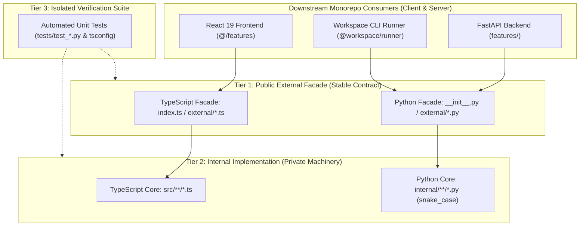

# Shared Packages Architecture — The Golden Architectural Invariants & Rules

> **Scope**: Monorepo Workspace Architectural Rules & Engineering Invariants  
> **Applies to**: `@workspace/config`, `@workspace/logger`, `@workspace/runner`, and all future shared packages  
> **Status**: `MANDATORY WORKSPACE SPECIFICATION` · Zero-Drift Policy Enforced

---

## 2-Tier Package Architecture Topology

All shared packages in `Soul-DevPortal-Packages/` must strictly decouple their **Public External Facade** from their **Internal Implementation Engine**:



---

## Part I: The 8 Golden Invariants of Shared Packages

> [!IMPORTANT]
> A shared package is foundational infrastructure. A bug or breaking change in a shared package cascades to all 9 applications simultaneously. Every shared library must adhere strictly to these 8 invariants.

### 1. Strict 2-Tier Architecture & Facade Encapsulation
- Every package must strictly decouple its **Public External Facade** from its **Internal Implementation**.
- Consumers must import only from approved public facades:
  - Python: `from logger.external import get_logger, server_logger` or `from workspace_logger import get_logger`
  - TypeScript: `import { consoleLogger } from '@workspace/logger'`
- Direct deep imports into internal files (e.g. `import ... from '@workspace/logger/internal/sanitizer'`) are strictly prohibited and blocked by export maps.

---

### 2. Snake_case Identifiers for Python Modules
- All Python file names within package internals and externals must use standard snake_case identifiers (e.g. `logger_engine.py`, `run_dev.py`, `format_handlers.py`), **never** kebab-case (e.g. `run-dev.py`).

> [!CAUTION]
> Hyphenated Python filenames cause fatal syntax errors on standard imports (`import external.run-dev` is invalid Python). Snake_case allows files to function seamlessly both as executable CLI scripts and importable modules.

---

### 3. Zero Redundant Shims & DRY Canonical Implementations
- Every shared package must have exactly one canonical implementation of any feature.
- Never introduce duplicate fallback wrapper shims or competing utility implementations. If an API evolves, refactor the canonical engine and export backward-compatible aliases from the facade with `@deprecated` docstrings.

---

### 4. Triple-Manifest Parity
Packages supporting both Node.js and Python ecosystems must maintain strict metadata, versioning, and name synchronization across three manifest files:
1. `package.json` (NPM workspace manifest with subpath exports)
2. `pyproject.toml` (Modern PEP 517/621 build specification)
3. `setup.py` (Legacy and editable `pip install -e` compatibility)

Discrepancies in version or dependencies across these manifests trigger immediate CI rejection.

---

### 5. Mandatory Isolated Unit Verification Suite
- A shared package must **never** rely on downstream projects to test its functionality.
- Every package must contain an isolated test suite (`tests/` directory) with automated tests verifying:
  - Facade exports and public signatures (`test_external.py`).
  - Internal core engine mechanics and sanitizers (`test_internal.py`).
  - TypeScript compilation and type definitions (`tsc --noEmit`).

---

### 6. Subpath Exports & Explicit Type Declarations
Every shared package must declare explicit `exports` maps in `package.json` to define supported subpath import entrypoints:

```json
{
  "name": "@workspace/logger",
  "version": "1.0.0",
  "type": "module",
  "exports": {
    ".": "./client/index.ts",
    "./vite-plugin": "./client/vite-plugin.ts",
    "./types": "./client/types.ts"
  },
  "typesVersions": {
    "*": {
      "vite-plugin": ["./client/vite-plugin.d.ts"]
    }
  }
}
```

---

### 7. Deterministic `sys.path` Priority & Anti-Shadowing
- Executable Python scripts in `external/` must prepend their own package root at **index 0** of `sys.path`.
- Sibling packages (`logger`, `config`) are **appended** at the end:

```python
import sys
from pathlib import Path

_pkg_root = Path(__file__).resolve().parent.parent
if str(_pkg_root) in sys.path:
    sys.path.remove(str(_pkg_root))
sys.path.insert(0, str(_pkg_root))

_packages_root = _pkg_root.parent
for _pkg in ("logger", "config"):
    _p = str(_packages_root / _pkg)
    if _p not in sys.path:
        sys.path.append(_p)
```

> [!NOTE]
> This deterministic order prevents sibling packages that both have an `internal/` directory from shadowing each other during runtime execution.

---

### 8. Polyglot Zero-Config Consumption
- Shared libraries must work out-of-the-box without requiring bespoke bundler configurations or loader hacks in consumer projects.
- TypeScript packages distribute clean ES modules (`esm`) and declaration typings (`.d.ts`).
- Python packages install cleanly in editable mode (`pip install -e Soul-DevPortal-Packages/<pkg>`).

---

## Part II: Package-Specific Architectural Standards

### 1. `@workspace/logger` Invariants
- **5-Column Format**: All server log lines must output in deterministic 5-column format:
  `[TIMESTAMP] [LEVEL] [SERVICE] [TRACE_ID] MESSAGE`
- **PII & Secret Masking**: Automatic regex masking of sensitive tokens (`api_key`, `password`, `secret`, `bearer`, `jwt`). Never emit raw secrets in plain text.
- **Client Console Bridge**: `consoleLogger` must colorize browser console logs with semantic badges and formatted JSON payloads.
- **Vite Plugin**: Must attach HMR dev server banners on boot.

---

### 2. `@workspace/config` Invariants
- **Single Source of Truth**: Port allocations, Tailwind v4 design tokens, and TypeScript presets must live here.
- **Zero Drift Port Matrix**: Ports defined in `@workspace/config` must match `projects.json` with 100% parity.
- **Pure CSS Tailwind v4**: Export CSS custom property presets under `@theme` for instant import in downstream apps.

---

### 3. `@workspace/runner` Invariants
- **Atomic Process Supervision**: Child processes must be managed via Windows Job Objects (`JOB_OBJECT_LIMIT_KILL_ON_JOB_CLOSE`) or POSIX process groups (`os.setsid`).
- **Sub-Second Active Socket Prober**: Probe TCP port readiness using non-blocking socket connect before reporting service status.
- **Interactive Hotkeys**: Support `[r]` restart backend, `[f]` restart frontend, `[p]` process telemetry, `[c]` clear screen, `[q]` quit.

---

## Part III: Invariant Violation Catalog & Remediation

| Violation | Immediate Failure Symptom | Mandatory Remediation |
| :--- | :--- | :--- |
| **Deep internal import** | Build failure in production bundle | Export symbol via `external/__init__.py` or `index.ts`; import via root facade |
| **Kebab-cased Python file** | `SyntaxError: invalid syntax` on `import` | Rename to snake_case (`run-dev.py` -> `run_dev.py`) |
| **Manifest version drift** | `package.json` != `pyproject.toml` | Synchronize versions across all 3 manifest files |
| **Missing isolated tests** | Regression in downstream projects | Add `tests/test_internal.py` and `tests/test_external.py` |
| **Unmasked sensitive logs** | Secret leaks in logs/audits | Route log messages through `@workspace/logger` masking engine |
| **Zombie processes** | `EADDRINUSE` port collision | Wrap process launch in `@workspace/runner` with `--kill-port` flag |
