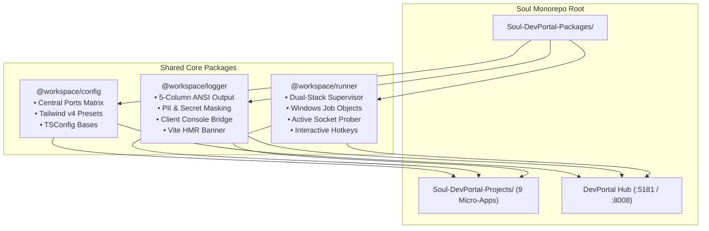

# Shared Packages Architecture — Master Technical Blueprint & Guide

> **Scope**: Monorepo Shared Libraries (`@workspace/*`) & Cross-Runtime Polyglot Tooling  
> **Applies to**: `@workspace/config`, `@workspace/logger`, `@workspace/runner`, and all future shared packages  
> **Status**: `AUTHORITATIVE ARCHITECTURE BLUEPRINT`

---

## Architecture Topology Overview

The Soul Monorepo centralizes all reusable functionality into `Soul-DevPortal-Packages/` (hosted in its own repository at `https://github.com/dheena017/Soul-DevPortal-Packages.git` and linked locally into `Soul-DevPortal`). These **78** packages are consumed polyglot across both TypeScript (via NPM workspaces) and Python (via pip editable packages):



---

## 1. Deep Dive: The Three Core Workspace Packages

### 1.1 `@workspace/config` (Centralized Configuration & Presets)

#### Core Purpose
`@workspace/config` serves as the authoritative single source of truth for:
- Workspace port allocations and network topology.
- Standardized TypeScript compiler configurations (`tsconfig.json`).
- Tailwind CSS v4 design tokens and color scales.
- Code style rules (`prettier`, `eslint`, `pyproject.toml`).

#### Module Architecture & Exports
```text
Soul-DevPortal-Packages/config/
├── package.json                   # NPM manifest with subpath exports
├── pyproject.toml                 # PEP 621 Python manifest
├── setup.py                       # Legacy setuptools build compatibility
├── README.md                      # Package documentation
├── index.js                       # JavaScript/TypeScript design tokens & Tailwind preset
├── internal/                      # Tier 1: Core engines (ports, tokens, env)
│   ├── ports_integrity.py        # Port matrix verification and JSON sync
│   └── token_definitions.ts       # Shared theme variables
├── external/                      # Tier 2: Public facade, run_ports.py & presets/
│   ├── run_ports.py               # Active TCP port conflict auditor CLI
│   └── presets/                   # Presets for tsconfig, tailwind, prettier, eslint
│       ├── tsconfig/react.json    # React 19 + Vite tsconfig preset
│       ├── tsconfig/node.json     # Node.js backend tsconfig preset
│       └── tailwind/preset.js     # Shared design system theme preset
└── tests/                         # Tier 3: Verification suite
    ├── test_ports_integrity.py    # Automated port matrix test
    ├── test_internal.py           # Unit tests for internal logic
    └── test_external.py           # Unit tests for public CLI runners
```

#### Consumption Patterns

**A. TypeScript Configuration (`client/tsconfig.json`)**:
```json
{
  "extends": "@workspace/config/tsconfig/react.json",
  "include": ["src"]
}
```

**B. Tailwind CSS v4 Integration (`client/src/index.css`)**:
```css
@import "tailwindcss";

@theme {
  --color-brand-primary: #3b82f6;
  --color-surface-obsidian: #09090c;
  --font-mono: 'JetBrains Mono', monospace;
}
```

**C. Port Conflict Scanner CLI**:
```bash
# Scan all monorepo ports for collisions or zombie processes
python Soul-DevPortal-Packages/config/external/run_ports.py

# Automatically terminate rogue processes holding workspace ports
python Soul-DevPortal-Packages/config/external/run_ports.py --kill-conflicts
```

---

### 1.2 `@workspace/logger` (5-Column Telemetry & PII Masking)

#### Core Purpose
`@workspace/logger` provides enterprise-grade structured observability across all client and server runtimes:
- Deterministic 5-column ANSI terminal logging.
- Automatic regular-expression masking of secrets, tokens, and passwords.
- Browser console logging bridge with colored tags and expandable JSON payloads.
- Vite plugin for injecting development server startup banners and HMR telemetry.
- FastAPI / Starlette request logging middleware with execution latency measurement.

#### Module Architecture & Exports
```text
Soul-DevPortal-Packages/logger/
├── package.json
├── pyproject.toml
├── setup.py
├── README.md
├── tsconfig.json
├── client/                        # TypeScript browser logger & Vite HMR bridge
│   ├── index.ts                   # Public browser consoleLogger export
│   ├── vite-plugin.ts             # Workspace dev server banner Vite plugin
│   └── types.ts                   # LogLevel and LoggerOptions interfaces
├── internal/                      # Tier 1: Core ANSI formatters, sanitizer, box renderer
│   ├── sanitizer.py               # Automated PII & secret regex masking engine
│   ├── formatter.py               # 5-column ANSI layout generator
│   └── box_renderer.py            # Unicode CLI banner frame renderer
├── external/                      # Tier 2: Public server_logger, middleware, banners
│   ├── __init__.py                # Root facade exporting get_logger, server_logger
│   ├── middleware.py              # FastAPI / Starlette logging middleware
│   └── server_logger.py           # Universal server-side logging class
└── tests/                         # Tier 3: Unit tests
    ├── test_internal.py           # Tests sanitizer and formatters
    └── test_external.py           # Tests middleware and facade re-exports
```

#### Consumption Patterns

**A. Browser & React Applications (`client/src/App.tsx`)**:
```typescript
import { consoleLogger } from '@workspace/logger';

// Colored structured logging in browser console
consoleLogger.info('AUTH', 'User session established', { userId: 'usr_9281' });
consoleLogger.action('CART', 'Item added to checkout', { itemsCount: 3 });
consoleLogger.error('API', 'Payment gateway timeout', new Error('Gateway Timeout 504'));
```

**B. Vite HMR Dev Server Banner (`client/vite.config.ts`)**:
```typescript
import { defineConfig } from 'vite';
import { workspaceLoggerPlugin } from '@workspace/logger/vite-plugin';

export default defineConfig({
  plugins: [
    workspaceLoggerPlugin({
      serviceName: 'APEXMIND STUDIO AI',
      version: '1.0.0',
      port: 5173,
    }),
  ],
});
```

**C. Python FastAPI Backend (`server/main.py`)**:
```python
from fastapi import FastAPI
from logger.external import get_logger
from logger.external.middleware import init_app_logger

app = FastAPI(title="ApexMind Studio AI")
init_app_logger(app, title="APEXMIND STUDIO", port=8000)

logger = get_logger("API")

@app.get("/api/v1/sessions")
async def get_sessions():
    logger.info("Retrieved active user sessions", extra={"count": 14})
    return {"sessions": []}
```

---

### 1.3 `@workspace/runner` (Process Supervision & Healthcheck Probing)

#### Core Purpose
`@workspace/runner` provides atomic process management, port conflict resolution, and active readiness verification across all 9 micro-applications:
- **Kernel-Level Sandboxing**: Windows Job Objects (`JOB_OBJECT_LIMIT_KILL_ON_JOB_CLOSE`) and POSIX process groups (`os.setsid`) to guarantee 100% atomic child process cleanup on exit.
- **Sub-Second Active Socket Probing**: Non-blocking TCP socket connect before reporting service status.
- **Interactive Terminal Hotkeys**:
  - `[r]`: Restart backend server.
  - `[f]`: Restart frontend client.
  - `[p]`: Display live process CPU & memory telemetry.
  - `[c]`: Clear terminal console.
  - `[q]`: Cleanly exit all child processes and release ports.

#### Module Architecture & Exports
```text
Soul-DevPortal-Packages/runner/
├── package.json
├── pyproject.toml
├── setup.py
├── README.md
├── internal/                      # Tier 1: Supervisor, controller, sandboxing, ports
│   ├── supervisor.py              # Master multi-process coordinator
│   ├── job_objects.py             # Windows Job Object kernel sandboxing
│   ├── socket_prober.py           # Non-blocking TCP readiness prober
│   └── hotkeys.py                 # Interactive terminal hotkey listener
├── external/                      # Tier 2: Public CLI runners
│   ├── run_dev.py                 # Fullstack dev runner with port-kill
│   ├── run_client.py              # Standalone frontend client launcher
│   ├── run_server.py              # Standalone backend server launcher
│   └── run_ports.py               # Port scanner CLI
└── tests/                         # Tier 3: Unit tests
    ├── test_registry.py           # Projects registry validator
    └── test_supervisor.py         # Supervisor lifecycle tests
```

#### Consumption Patterns

**A. Fullstack Development with Automatic Port Cleanup**:
```bash
# Launch both client and server concurrently with automatic port conflict resolution
python Soul-DevPortal-Packages/runner/external/run_dev.py --project apexmind-ai --kill-port --open

# Or via monorepo npm scripts:
npm run dev:apexmind
```

**B. Launching All 9 Applications Concurrently**:
```bash
# Boots the full monorepo stack with managed supervisor
npx @workspace/runner all
```

---

## 2. Standardized Packages Layout & Directory Architecture

Every shared library in `Soul-DevPortal-Packages/` strictly implements the 3-Tier standard:

```text
Soul-DevPortal-Packages/<package-name>/
├── package.json                   # NPM manifest with subpath exports & run/demo/test scripts
├── pyproject.toml                 # Modern PEP 517/621 build specification
├── setup.py                       # Legacy setuptools build compatibility
├── README.md                      # Architectural overview, API exports & Running Scripts table
├── Preview/                       # Live DevPortal Preview & Interactive/Demo CLI Runners
│   ├── preview.json               # Manifest (title, features, runCommand, demoCommand, sampleInputs)
│   ├── USAGE.md                   # Standardized CLI & script usage guide
│   └── run_<pkg_snake>.py         # Interactive + --demo + --json + --health ANSI-colored runner
├── internal/                      # Tier 1: Private Engine (Consumers must NOT import)
│   ├── __init__.py                # Package initialization
│   ├── models.py                  # Pydantic v2 input/output schemas
│   └── engine.py                  # Core algorithms and business logic (snake_case)
├── external/                      # Tier 2: Public External Facade
│   ├── __init__.py                # Explicit __all__ facade exports
│   ├── routes.py                  # FastAPI APIRouter endpoints
│   └── client/                    # Typed TypeScript/React 19 client facade
└── tests/                         # Tier 3: Isolated Verification Suite
    ├── test_internal.py           # Unit tests targeting internal core
    └── test_external.py           # Integration tests targeting public facade & Preview runner
```

---

## 3. Step-by-Step Package Authoring Playbook

Follow this 7-step runbook when creating a new shared library in `Soul-DevPortal-Packages/`:

### Step 1: Package Naming Conventions
* **NPM / TypeScript Scope**: `@workspace/<name>` (lowercase kebab-case).
* **Python / PyPI Scope**: `workspace-<name>` (module name: `workspace_<name>`).

### Step 2: Scaffold 3-Tier & Preview Directories
```bash
mkdir -p Soul-DevPortal-Packages/<name>/internal
mkdir -p Soul-DevPortal-Packages/<name>/external
mkdir -p Soul-DevPortal-Packages/<name>/tests
mkdir -p Soul-DevPortal-Packages/<name>/Preview
touch Soul-DevPortal-Packages/<name>/internal/__init__.py
touch Soul-DevPortal-Packages/<name>/external/__init__.py
```

### Step 3: Implement Private Core (`internal/`)
```python
# Soul-DevPortal-Packages/<name>/internal/engine.py
def calculate_metric(data: list[float]) -> float:
    if not data:
        return 0.0
    return sum(data) / len(data)
```

### Step 4: Expose Public Facade (`external/__init__.py`)
```python
# Soul-DevPortal-Packages/<name>/external/__init__.py
from internal.engine import calculate_metric

__all__ = ["calculate_metric"]
```

### Step 5: Author Synchronized Manifests

**A. `package.json`**:
```json
{
  "name": "@workspace/<name>",
  "version": "2.0.0",
  "private": true,
  "type": "module",
  "scripts": {
    "run": "python Preview/run_<name_snake>.py",
    "demo": "python Preview/run_<name_snake>.py --demo",
    "demo:json": "python Preview/run_<name_snake>.py --demo --json",
    "test": "python tests/test_internal.py && python tests/test_external.py"
  },
  "exports": {
    ".": "./external/client/index.ts"
  }
}
```

**B. `pyproject.toml`**:
```toml
[build-system]
requires = ["setuptools>=61.0"]
build-backend = "setuptools.build_meta"

[project]
name = "workspace-<name>"
version = "2.0.0"
description = "Shared package in Soul monorepo"
authors = [{ name = "Soul Team" }]

[tool.setuptools.packages.find]
where = ["."]
include = ["internal*", "external*"]
```

**C. `setup.py`**:
```python
from setuptools import setup, find_packages
setup(name="workspace-<name>", version="2.0.0", packages=find_packages())
```

### Step 6: Verify Isolated Test Suite
```bash
python Soul-DevPortal-Packages/<name>/tests/test_internal.py
python Soul-DevPortal-Packages/<name>/tests/test_external.py
```

### Step 7: Add Live Runtime Preview (`Preview/` + `Package Preview` Tab)
Every package includes a `Preview/` folder automatically crawled by `server/shared/extractors/packages_crawler.py` and rendered in `src/features/packages/detail/PackagePreviousTab.tsx`:
- **`Preview/run_<pkg_snake>.py`**: Interactive prompt mode (with inline `min_val`/`max_val` range validation), `--demo` non-interactive sample run, `--input-json`, `--json`, `--health`, `--no-color`, and ANSI terminal colors.
- **`Preview/USAGE.md`**: Standardized usage table and sample JSON payload.
- **`Preview/preview.json`**: Includes `script`, `runCommand`, `demoCommand`, `jsonDemoCommand`, `sampleInputs`, and `commands` for the **Quick Run & Demo** card.

---

## 4. DevPortal Package Inspector Tabs

Every package in `Soul-DevPortal-Packages/` is rendered in `PackageDetailView` with 5 canonical tabs:

| Tab | Component | Purpose |
| :--- | :--- | :--- |
| **Documentation** | `PackageDocsTab.tsx` | Parsed `README.md` guides and architecture notes |
| **API & Exports** | `PackageApiTab.tsx` | TypeScript & Python exported symbols and signatures |
| **Code Generator** | `PackagePlaygroundTab.tsx` | Copy-ready import snippets and usage boilerplate |
| **Manifest & Metadata** | `PackageManifestTab.tsx` | `package.json`, `pyproject.toml`, scripts, and dependencies |
| **Package Preview (`LIVE`)** | `PackagePreviousTab.tsx` | **Quick Run & Demo** copyable commands (`run`, `demo`, `demo:json`), sample inputs, and tabbed file viewer (`USAGE.md`, `run_<pkg>.py`, `preview.json`) |

---

## 5. Automated Verification Suite & Manifest Parity

To ensure zero drift across all shared packages, execute the complete verification suite:

```powershell
python Soul-DevPortal-Packages/config/tests/test_ports_integrity.py; `
python Soul-DevPortal-Packages/config/tests/test_internal.py; `
python Soul-DevPortal-Packages/config/tests/test_external.py; `
python Soul-DevPortal-Packages/runner/tests/test_registry.py; `
python Soul-DevPortal-Packages/runner/tests/test_supervisor.py; `
python Soul-DevPortal-Packages/logger/tests/test_internal.py; `
python Soul-DevPortal-Packages/logger/tests/test_external.py; `
npx tsc --noEmit -p Soul-DevPortal-Packages/logger/tsconfig.json; `
python scripts/test_all_packages.py
```

---

## 6. Complete 78-Package Studio & AI Ecosystem Map

Across the three workspace infrastructure packages (`config`, `logger`, `runner`) and **75 modular studio & AI packages** (**78 total**), `Soul-DevPortal-Packages/` is tailored to **React 19 + Vite 8 + Tailwind 4** (Frontend) and **FastAPI + Uvicorn + SQLite WAL** (Backend):

### Layer 0 & Layer 1 — Core Foundation & AI Orchestration (4 Packages)

| Folder | NPM Scope | Frontend (React 19 + Vite 8) | Backend (FastAPI + SQLite WAL) | Purpose |
| :--- | :--- | :--- | :--- | :--- |
| `core/` | `@workspace/core` | `react` (19), `vite` (8), `tailwindcss` (4), `@tanstack/react-query`, `zustand`, `react-router`, `lucide-react`, `openapi-fetch` | `fastapi[standard]`, `uvicorn[standard]`, `sqlalchemy[asyncio]`, `aiosqlite` (WAL), `alembic`, `pydantic-settings`, `httpx`, `ffmpeg` | Base app shell, SQLite WAL engine, Vite 8 FFmpeg/WASM preset |
| `ai-agents/` | `@workspace/ai-agents` | `@ai-sdk/react`, `EventSource` (SSE) | `pydantic-ai`, `google-genai`, `openai`, `anthropic` | Scriptwriting, shot lists, prompt enhancement, structured JSON |
| `ai-router/` | `@workspace/ai-router` | `@tanstack/react-query` | `litellm`, `fal-client`, `replicate` | Unified routing between Cloud APIs & local GPUs |
| `ai-local/` | `@workspace/ai-local` | `@huggingface/transformers` (WebGPU/WASM) | `diffusers`, `transformers`, `torch`, `onnxruntime-gpu` | Local GPU & browser WebGPU inference for open-weight models |

### Layer 2 — 13 Studio Domains (71 Category Packages)

| # | Domain | Count | Packages | Key Stack |
| :--- | :--- | :---: | :--- | :--- |
| **1** | Video & Film | 9 | `movie-maker`, `video-editor`, `motion-2d`, `vfx-engine`, `color-luts`, `subtitles`, `screen-recorder`, `gif-clipper`, `video-transcoder` | `faster-whisper`, `whisperx`, `Qwen3-ASR`, `NVIDIA Nemotron 3.5 ASR`, `ffmpeg` |
| **2** | Image & Design | 6 | `image-maker`, `image-editor`, `vector-draw`, `bg-remover`, `image-upscaler`, `whiteboard` | `FLUX.1`, `SDXL`, `comfyui`, `pyvips`, `rembg`, `realesrgan`, `tldraw`, `excalidraw` |
| **3** | Audio & Music | 6 | `audio-maker`, `audio-editor`, `audio-cleanup`, `stem-splitter`, `podcast-studio`, `audio-analyzer` | `Kokoro 82M`, `ACE-Step 1.5`, `wavesurfer.js`, `pedalboard`, `deepfilternet`, `demucs`, `librosa` |
| **4** | 3D & Spatial | 3 | `scene-3d`, `render-3d`, `viewer-3d` | `three`, `@react-three/fiber`, `bpy`, `trimesh`, `cadquery`, `@google/model-viewer` |
| **5** | Publishing, Live & Management | 4 | `pdf-decks`, `live-stream`, `dam-search`, `media-info` | `@react-pdf/renderer`, `weasyprint`, `@livekit/components-react`, `hls.js`, `sqlite-vec`, `ffprobe` |
| **6** | Generative AI & Avatars | 7 | `ai-video`, `ai-avatars`, `ai-dubbing`, `text-video-edit`, `ai-inpaint`, `ai-rigging`, `ai-3d` | `LTX-2.5`, `Veo 3.1`, `Wan 3.0`, `Kling 4.0`, `MuseTalk`, `sam2`, `triposr`, `hunyuan3d` |
| **7** | Brand, Marketing & E-Commerce | 6 | `brand-kits`, `batch-render`, `mockups-tryon`, `auto-reframe`, `watermark-qr`, `stock-media` | `Tailwind 4 @theme`, `fonttools`, `remotion`, `huey`, `ultralytics`, `mediapipe`, `segno` |
| **8** | Spatial, Interactive & Data Media | 5 | `splats-3d`, `spatial-xr`, `branch-video`, `data-charts`, `code-video` | `nerfstudio`, `gsplat`, `@react-three/xr`, `d3`, `recharts`, `manim`, `shiki-magic-move` |
| **9** | Studio Workflow & Delivery | 8 | `scriptwriter`, `frame-review`, `version-history`, `node-pipelines`, `media-proxy`, `render-queue`, `c2pa-sign`, `social-publish` | `WebSocket`, `@xyflow/react`, `networkx`, `huey` (`SqliteHuey`), `c2pa-python`, `apscheduler` |
| **10** | Design Systems & UI Export | 5 | `ui-tokens`, `ui-prototype`, `ui-studio`, `ui-export`, `a11y-audit` | Design tokens, WCAG 2.1, React/HTML export |
| **11** | Game Dev & Physics | 4 | `game-2d`, `physics-3d`, `shader-graph`, `npc-ai` | 2D/3D simulation, shaders, behavior trees |
| **12** | Security, Auth & Metering | 4 | `auth-rbac`, `ai-credits`, `media-drm`, `audit-logs` | RBAC, token metering, DRM licensing, audit trails |
| **13** | Testing, Telemetry & Eval | 4 | `ai-evals`, `media-qc`, `dataset-studio`, `telemetry` | EBU-R128 QC, LLM evals, datasets, telemetry |

### Critical Stack Configuration Notes
1. **Vite 8 + FFmpeg.wasm**: `vite.config.js` excludes `@ffmpeg/ffmpeg` and `@ffmpeg/util` from `optimizeDeps` and supports `Cross-Origin-Opener-Policy: same-origin` + `Cross-Origin-Embedder-Policy: require-corp` when `VITE_ENABLE_SHARED_ARRAY_BUFFER=true`.
2. **SQLite WAL + Background Jobs**: Use `huey` (`SqliteHuey`) or `tinyjobs` for render queues, batch jobs, and scheduled social posts directly on SQLite WAL without Redis or RabbitMQ.
