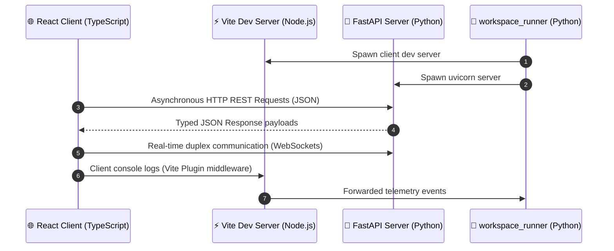

# Cross-Stack Integration & Communication

The monorepo connects Python and TypeScript through decoupled, standard protocols:

1. **HTTP REST**: Clients consume typed JSON endpoints served by FastAPI.
2. **WebSockets**: Bi-directional real-time data streaming for live AI models and notifications.
3. **Dev Server Telemetry**: Client-side logs are captured via `@workspace/logger`'s Vite plugin and displayed cleanly in the terminal alongside server logs.

---
