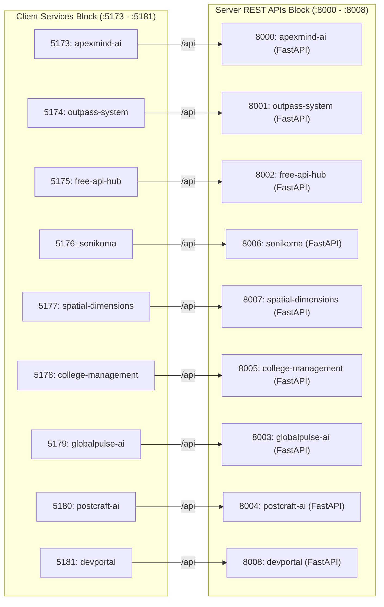

# Networking & Ports Architecture — The Golden Architectural Invariants & Rules

> **Scope**: Monorepo Workspace Architectural Rules & Engineering Invariants  
> **Applies to**: All client applications, backend services, dev proxies, and process supervisors  
> **Status**: `MANDATORY WORKSPACE SPECIFICATION` · Zero-Drift Policy Enforced

---

## Deterministic Port Partitioning Map

The Soul Monorepo enforces a strict mathematical port partitioning topology to guarantee simultaneous, collision-free execution of all 9 applications:



---

## Part I: The 8 Golden Invariants of Networking & Ports

> [!IMPORTANT]
> Port stability is critical for microservice concurrency. Binding to an unassigned port breaks Vite reverse proxying, causes port prober desynchronization, and triggers CI audit failures.

### 1. Deterministic Port Block Partitioning
- **Client Applications**: Strictly confined to the port range **`5173` through `5181`**.
- **Backend Services**: Strictly confined to the port range **`8000` through `8008`**.
- **Developer Portal**: Hub ingress bound permanently to `:5181` (Client) and `:8008` (Server).
- **Invariant**: No process may bind to random, arbitrary, or undocumented ports outside its assigned block.

---

### 2. Immutable Project Port Mapping
Every project has an assigned, immutable client and server port pair declared in `projects.json` and `metadata.json`:

| Project ID | Title | Client Port | Server Port |
| :--- | :--- | :---: | :---: |
| `apexmind-ai` | ApexMind Studio AI | `:5173` | `:8000` |
| `outpass-system` | Outpass Management System | `:5174` | `:8001` |
| `free-api-hub` | Free API Hub | `:5175` | `:8002` |
| `globalpulse-ai` | GlobalPulse AI | `:5179` | `:8003` |
| `postcraft-ai` | PostCraft AI | `:5180` | `:8004` |
| `college-management-system` | College Management System | `:5178` | `:8005` |
| `sonikoma` | Sonikoma AI Studio | `:5176` | `:8006` |
| `spatial-dimensions` | Spatial Dimensions | `:5177` | `:8007` |
| `devportal` | Soul Developer Portal | `:5181` | `:8008` |

> [!CAUTION]
> Developers must never alter project ports locally. If a port conflict occurs, do not change the port number — terminate the conflicting zombie process.

---

### 3. Standard Reverse Proxy Contract (`/api` & `/ws`)
- Client code must communicate with backends exclusively via relative URLs (`/api/...` and `/ws/...`).
- Hardcoding backend origins (`http://localhost:8000/api`) in client source code is strictly prohibited.
- The client Vite dev server forwards all `/api` and `/ws` traffic transparently to the corresponding backend port with `strictPort: true`:

```typescript
// client/vite.config.ts
export default defineConfig({
  server: {
    port: 5173,
    strictPort: true, // Prevents silent port hopping
    host: '127.0.0.1',
    proxy: {
      '/api': { target: 'http://127.0.0.1:8000', changeOrigin: true },
      '/ws': { target: 'ws://127.0.0.1:8000', ws: true },
    },
  },
});
```

---

### 4. Zero Orphan Sockets & Automated Force Termination
- Processes must cleanly release TCP sockets upon receiving `SIGINT` (`Ctrl+C`) or `SIGTERM`.
- The monorepo supervisor (`@workspace/runner`) probes target sockets and automatically terminates orphaned zombie processes before starting services (`--kill-port` flag).
- All applications must handle graceful shutdown within a 5-second window.

---

### 5. Safe Local Host Binding (`127.0.0.1`)
- In local development, all servers and dev proxies must bind explicitly to loopback `127.0.0.1` or `localhost`.
- **Prohibition**: Never bind development servers to `0.0.0.0` (all network interfaces) without explicit firewall authorization, preventing accidental network exposure on public Wi-Fi.

---

### 6. Sub-Second Active Socket Probing Contract
- Before launching services or reporting service readiness, the runner must perform non-blocking TCP socket connect verification with a 150ms timeout.
- A service is declared `ONLINE` only when both client and server TCP sockets respond successfully.

---

### 7. Strict Port Isolation (`strictPort: true`)
- All Vite configurations must set `server.strictPort = true`.
- If the assigned port is occupied, Vite must **fail fast and exit**, rather than silently incrementing to an unassigned port (e.g. `5173` -> `5174`), which would collide with another micro-application.

---

### 8. Graceful Lifecycle Drain & Signal Interception
- Backends must trap OS termination signals (`SIGINT`, `SIGTERM`) and gracefully drain active HTTP connections before closing database handles.
- In Python FastAPI, implement this via the ASGI `lifespan` handler:

```python
@asynccontextmanager
async def lifespan(app: FastAPI):
    yield
    # Close database connections and release socket
```

---

## Part II: Incident Playbook: Port Conflicts & Socket Cleanup

### Scenario: `EADDRINUSE: Address already in use`

#### Step 1: Automated Force Cleanup (Recommended)
```bash
# Scan and kill any zombie processes holding workspace ports
python Soul-DevPortal-Packages/config/external/run_ports.py --kill-conflicts
```

#### Step 2: Windows Manual Diagnostic & Kill
```powershell
# 1. Identify rogue PID holding port 5173
netstat -ano | findstr :5173

# 2. Inspect process details
tasklist /FI "PID eq <PID>"

# 3. Terminate process forcefully
taskkill /F /PID <PID>
```

#### Step 3: Linux / macOS Manual Diagnostic & Kill
```bash
# Find and kill process holding port 8000
lsof -ti:8000 | xargs kill -9
```
