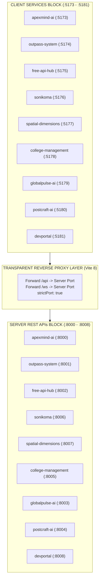

# Networking & Ports Architecture — Master Technical Blueprint & Guide

> **Scope**: Monorepo Port Topology, Network Partitioning & Socket Governance  
> **Applies to**: All client applications, backend services, dev proxies, and process supervisors  
> **Status**: `AUTHORITATIVE TECHNICAL BLUEPRINT`

---

## 1. Network Topology & Port Block Partitioning

All applications in the Soul Monorepo operate under a **deterministic, non-overlapping port allocation matrix**. Developers and supervisors can run all 9 applications concurrently without port collisions or cross-talk:



---

## 2. Master Project Port Allocation Matrix

The table below defines the authoritative network allocation across all applications in the monorepo:

| Project Name | Client Port | Client Framework | Server Port | Server Framework | Persistence Layer | Direct GitHub Repository |
| :--- | :---: | :--- | :---: | :--- | :--- | :--- |
| **`apexmind-ai`** | **`5173`** | React 19 + Vite 8 + Tailwind v4 | **`8000`** | Python FastAPI + Uvicorn | SQLite (`server/data/apexmind.db`) | [apexmind-ai](https://github.com/dheena017/apexmind-ai) |
| **`outpass-system`** | **`5174`** | React 19 + Vite 8 + Tailwind v4 | **`8001`** | Python FastAPI + Uvicorn | SQLite (`server/data/outpass.db`) | [outpass-system](https://github.com/dheena017/outpass-system) |
| **`free-api-hub`** | **`5175`** | React 19 + Vite 8 + Tailwind v4 | **`8002`** | Python FastAPI + Uvicorn | SQLite (`server/data/free_api_hub.db`) | [free-api-hub](https://github.com/dheena017/free-api-hub) |
| **`globalpulse-ai`** | **`5179`** | React 19 + Vite 8 + Tailwind v4 | **`8003`** | Python FastAPI + Uvicorn | SQLite (`server/data/globalpulse.db`) | [globalpulse-ai](https://github.com/dheena017/globalpulse-ai) |
| **`postcraft-ai`** | **`5180`** | React 19 + Vite 8 + Tailwind v4 | **`8004`** | Python FastAPI + Uvicorn | SQLite (`server/data/postcraft.db`) | [postcraft-ai](https://github.com/dheena017/postcraft-ai) |
| **`college-management`** | **`5178`** | React 19 + Vite 8 + Tailwind v4 | **`8005`** | Python FastAPI + Uvicorn | SQLite (`server/data/college_management.db`) | [college-management](https://github.com/dheena017/college-management-system) |
| **`sonikoma`** | **`5176`** | React 19 + Vite 8 + Tailwind v4 | **`8006`** | Python FastAPI + Uvicorn | SQLite (`server/data/sonikoma.db`) | [Sonikoma](https://github.com/dheena017/Sonikoma) |
| **`spatial-dimensions`** | **`5177`** | React 19 + Vite 8 + Tailwind v4 | **`8007`** | Python FastAPI + Uvicorn | SQLite (`server/data/spatial_dimensions.db`) | [spatial-dimensions](https://github.com/dheena017/spatial-dimensions) |
| **`devportal`** (Hub) | **`5181`** | React 19 + Vite 8 + Tailwind v4 | **`8008`** | Python FastAPI + Uvicorn | SQLite (`server/data/workspace.db`) | [Soul-DevPortal](https://github.com/dheena017/Soul-DevPortal) |

---

## 3. Reverse Proxy Architecture (`/api` & `/ws`)

Client applications must **never** hardcode backend origins or ports in application code. All network traffic uses transparent Vite reverse proxying:

```typescript
// client/vite.config.ts
import { defineConfig } from 'vite';
import react from '@vitejs/plugin-react';
import tailwindcss from '@tailwindcss/vite';

const CLIENT_PORT = 5173;
const BACKEND_PORT = 8000;

export default defineConfig({
  plugins: [react(), tailwindcss()],
  server: {
    port: CLIENT_PORT,
    strictPort: true, // Prevents silent fallback to arbitrary random ports
    host: '127.0.0.1',
    proxy: {
      '/api': {
        target: `http://127.0.0.1:${BACKEND_PORT}`,
        changeOrigin: true,
        secure: false,
      },
      '/ws': {
        target: `ws://127.0.0.1:${BACKEND_PORT}`,
        ws: true,
        changeOrigin: true,
      },
    },
  },
});
```

### Architectural Advantages:
1. **Zero Browser CORS Headaches**: Frontend requests originate and terminate on the same port (`:5173`), eliminating pre-flight `OPTIONS` latency and origin mismatch errors in local development.
2. **Production Topology Parity**: Directly mirrors production ingress architecture (where NGINX, Cloudflare, or an AWS ALB routes `/api` to the backend cluster).
3. **Seamless Protocol Upgrades**: Supports simultaneous HTTP REST calls and WebSocket streaming (`/ws`) over the exact same client connection origin.

---

## 4. Socket Cleanup & Zombie Process Management Protocol

Orphaned processes and unreleased sockets prevent clean service startups. The workspace enforces an automated socket cleanup runbook:

### 1. Active Non-Blocking TCP Socket Prober
The `@workspace/runner` package includes an active socket prober that inspects port health prior to launching:

```python
import socket

def is_port_in_use(port: int, host: str = "127.0.0.1", timeout: float = 0.15) -> bool:
    """Non-blocking TCP socket connect check."""
    with socket.socket(socket.AF_INET, socket.SOCK_STREAM) as s:
        s.settimeout(timeout)
        return s.connect_ex((host, port)) == 0
```

### 2. Kernel-Level Process Sandboxing
To eliminate zombie processes when developers close a terminal or invoke `Ctrl+C`, `@workspace/runner` wraps child processes:
- **Windows**: Uses Windows Job Objects with `JOB_OBJECT_LIMIT_KILL_ON_JOB_CLOSE`. When the parent terminal closes, Windows automatically terminates the entire child process tree.
- **Linux & macOS**: Uses POSIX process groups via `os.setsid()` and sends `SIGTERM` to `-os.getpgid(proc.pid)`.

### 3. Automated Force Termination CLI
```bash
# Scan and terminate any process occupying workspace ports
python Soul-DevPortal-Packages/config/external/run_ports.py --kill-conflicts
```

---

## 5. Healthcheck Probe Contracts (`GET /api/health` & `GET /api/ready`)

Every microservice backend must expose standardized probes for observability and automated supervision:

### Liveness Probe (`GET /api/health`)
```json
{
  "status": "healthy",
  "app": "apexmind-ai",
  "timestamp": "2026-11-24T12:00:00.000Z",
  "uptime_seconds": 1840,
  "db_connected": true
}
```

### Readiness Probe (`GET /api/ready`)
```json
{
  "ready": true,
  "app": "apexmind-ai",
  "checks": {
    "sqlite_wal": "ok",
    "gemini_api": "ok",
    "disk_space": "ok"
  }
}
```
