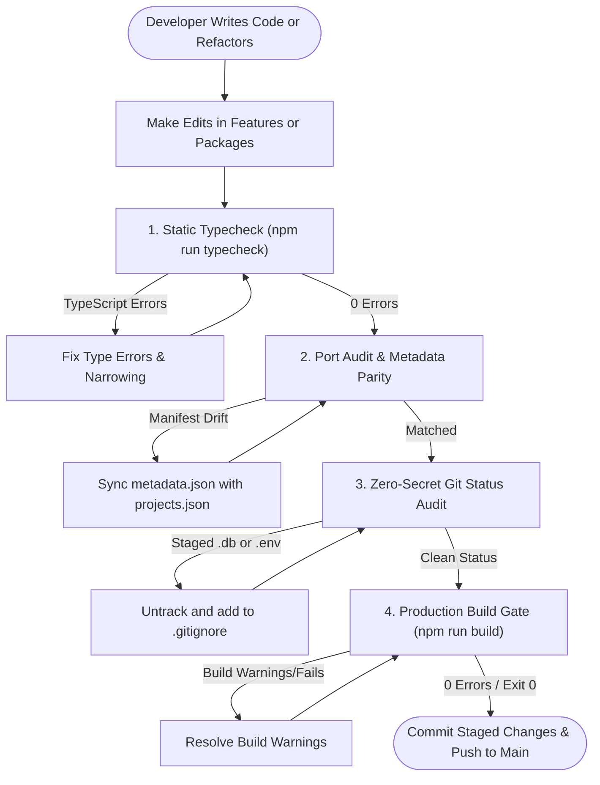

# Developer Workflows & Commands — The Golden Architectural Invariants & Rules

> **Scope**: Monorepo CLI Ergonomics, Script Standards & Audit Workflows  
> **Applies to**: Local development, CI automation, and workspace management across all 9 micro-applications  
> **Status**: `MANDATORY WORKSPACE SPECIFICATION` · Zero-Drift Policy Enforced

---

## Developer Workflow & Pre-Commit Audit Gate

The diagram below illustrates the mandatory pre-commit verification lifecycle that every developer must complete before staging or pushing changes:



---

## Part I: The 8 Golden Invariants of Developer Workflows

> [!IMPORTANT]
> Monorepo hygiene depends on deterministic workflows. Bypassing pre-commit audits or running fragmented scripts risks breaking shared packages and disrupting peer developers.

### 1. Root Workspace Execution over Fragmented Sub-Directory Runs
When executing multi-service commands (`dev`, `build`, `lint`), developers must run them from the repository root through `@workspace/runner` or standardized root npm scripts (e.g. `npm run dev:all`). Never start projects without port coordination.

---

### 2. Strict Port Isolation during Isolated Micro-App Runs
When working on an isolated child project (e.g. `Soul-DevPortal-Projects/apexmind-ai`), invoke the standard scripts:
- **Frontend**: `npm run dev:client` (binds strictly to assigned port, e.g. `5173`).
- **Backend**: `npm run dev:server` (binds strictly to assigned port, e.g. `8000`).
- **Invariant**: Never alter ports manually in code or command line without updating `projects.json`.

---

### 3. Pre-Commit Zero-Drift Compliance Audit Gate
Before pushing code or opening PRs, execute the compliance verification:
- `npm run typecheck`: Ensures zero TypeScript errors across portal, shared packages, and client apps.
- Verify `metadata.json` matches actual ports, dependencies, and frameworks.
- Verify zero `.db`, `.db-wal`, `.db-shm`, or `.env` files are staged in `git status`.

---

### 4. Immediate Zombie Process Termination over Port Reassignment
If a server fails to start with `EADDRINUSE` or `Address already in use`, do not change the port number. Execute the socket cleanup script:
```powershell
python Soul-DevPortal-Packages/config/external/run_ports.py --kill-conflicts
```

> [!CAUTION]
> Arbitrarily changing the port to `5174` or `8001` breaks Vite reverse proxying and collides with another micro-application in the monorepo.

---

### 5. Idempotent Environment Setup (`setup`, `install`)
Ensure environment setup scripts (`npm install`, `pip install -r requirements.txt`) are idempotent and safe to run multiple times without corrupting local SQLite databases or overwriting configured `.env` files.

---

### 6. Atomic SQLite WAL Operations & Zero-Copy Protocol
Never copy a live SQLite `.db` file using raw OS copy while the server is active. Always perform an online backup:
```bash
sqlite3 server/data/<app>.db ".backup server/data/<app>_backup.db"
```

---

### 7. Triple-Manifest Synchronization Invariant
Whenever modifying package names, versions, or exported symbols in shared libraries:
- Update `package.json`, `pyproject.toml`, and `setup.py` simultaneously.
- Verify package exports using `npx tsc --noEmit` and Python import verification.

---

### 8. Zero Plain-Text Secrets in Terminal Buffers or CI Outputs
Sensitive values (API keys, bearer tokens, database passwords) must **never** appear in plain text in terminal logs or CI artifacts.
- Mask secrets using `@workspace/logger` or standard obfuscation (`sk-...xxxx`).

---

## Part II: Developer Rapid Action Runbook

| Action Goal | Canonical Command | Expected Outcome |
| :--- | :--- | :--- |
| **Launch Full Monorepo** | `npm run dev:all` | Boots all 9 clients and servers concurrently with supervisor |
| **Launch Specific App** | `npm run dev:apexmind` | Boots ApexMind client (:5173) and backend (:8000) with port-kill |
| **Scan & Kill Port Collisions** | `python Soul-DevPortal-Packages/config/external/run_ports.py --kill-conflicts` | Terminate orphaned zombie processes on workspace ports |
| **Full Typecheck** | `npm run typecheck` | Validates TypeScript across workspace with 0 errors |
| **Production Build** | `npm run build` | Builds Vite production bundle into `dist/` |
