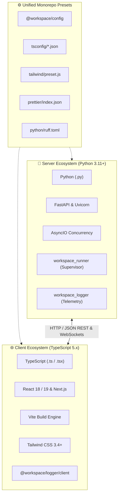
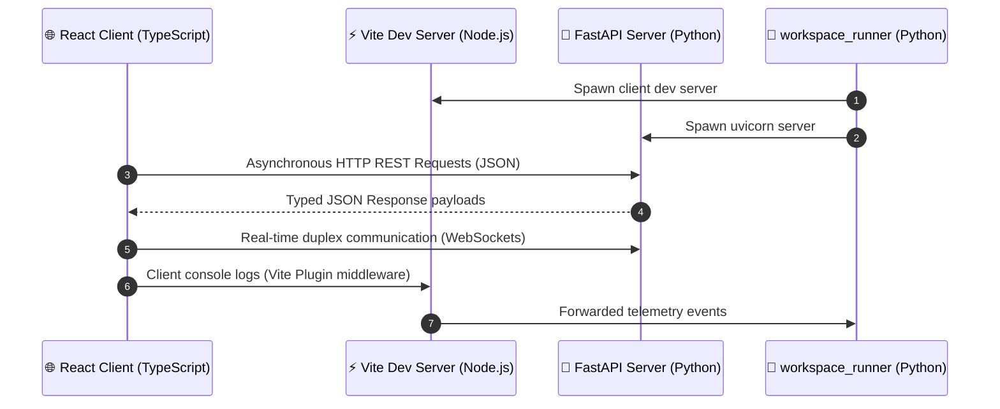

# Tech Stack & Ecosystem Standards

> **Polyglot Monorepo Baseline & Framework Specifications**  
> Complete technical reference detailing all programming languages, execution runtimes, frameworks, configuration formats, and interoperability patterns used across the workspace monorepo.

---

## 1. Executive Architecture Summary

This repository is built as a **High-Performance Polyglot Monorepo** powered by two primary programming languages working in concert:



---

## 2. Core Programming Languages Matrix

| Language | Extension | Role | Primary Runtime | Key Packages & Paths |
| :--- | :---: | :--- | :--- | :--- |
| **Python** | `.py` | Server APIs, backend orchestration, process management, terminal telemetry | Python 3.11+ / CPython | `packages/runner`, `packages/logger`, `Soul-DevPortal-Projects/*/server/` |
| **TypeScript** | `.ts`, `.tsx` | Client applications, UI components, client logic, type safety | Node.js 20+ / Browser | `packages/logger/src/`, `Soul-DevPortal-Projects/*/client/` |
| **JavaScript** | `.js`, `.mjs` | Build configurations, Tailwind presets, tooling scripts | Node.js 20+ | `packages/config/tailwind/`, `vite.config.ts` |
| **Tailwind CSS** | `.css` | Semantic design system, responsive layouts, micro-animations | PostCSS / Tailwind Engine | `packages/config/tailwind/preset.js`, `globals.css` |
| **JSON / JSONC** | `.json` | Package management, project manifests, compiler configs | Native Parsers | `package.json`, `projects.json`, `tsconfig/*.json` |
| **TOML / INI** | `.toml`, `.ini` | Python package manifests, linter configurations, test runners | Ruff / Pip / Pytest | `pyproject.toml`, `packages/config/python/ruff.toml` |
| **Markdown** | `.md` | Architectural documentation, API guides, component manuals | Markdown Renderers | `README.md`, `PACKAGES_DESIGN_GUIDE.md` |

---

## 3. Deep Dive: The Two Primary Languages

### A. Python (`.py`) — The Server & Systems Language

Python serves as the backbone for asynchronous microservices, CLI tooling, and development process orchestration.

#### Key Responsibilities

1. **Process Orchestration (`workspace_runner`)**:
   - Manages simultaneous lifecycle execution for all micro-app clients and servers.
   - Enforces Windows Job Object binding so child processes cleanly terminate on `Ctrl+C`.
2. **System Telemetry & Logging (`workspace_logger`)**:
   - Formats enterprise terminal banners, timestamps, and log severities (`INFO`, `WARN`, `ERROR`, `DEBUG`).
3. **Microservice APIs (`Soul-DevPortal-Projects/*/server/`)**:
   - High-throughput asynchronous HTTP REST and WebSocket APIs powered by **FastAPI** and **Uvicorn**.

#### Python Architectural Rules

- **Strict Editable Installation**: Every shared Python library must be installed via `pip install -e packages/<name>`.
- **Zero `sys.path` Hacks**: Source code and scripts **must never** call `sys.path.insert()` or `sys.path.append()`. All packages resolve naturally through environment path pointers.
- **Standard Package Layout**: All internal Python code resides in canonical `workspace_<package_slug>/` modules containing a `py.typed` marker (PEP 561).

---

### B. TypeScript (`.ts`, `.tsx`) — The Client & Application Language

TypeScript provides 100% type-safe client-side application logic and reactive user interfaces.

#### Key Responsibilities

1. **Modern Client Micro-Apps (`Soul-DevPortal-Projects/*/client/`)**:
   - Single Page Applications (SPAs) built with **React** and bundled via **Vite**.
   - Server-Side Rendered (SSR) apps built with **Next.js**.
2. **Client Telemetry (`@workspace/logger/client`)**:
   - Intercepts and bridges client-side console logs and unhandled errors directly to terminal telemetry.
3. **Shared Type Definitions & Contracts**:
   - Defines strict interfaces for API responses, UI component props, and shared utilities.

#### TypeScript Architectural Rules

- **Unified Compiler Presets**: Projects never duplicate 40-line `tsconfig.json` files; they extend `@workspace/config/tsconfig/<target>.json`.
- **Strict Null & Index Safety**: All projects enforce `noUncheckedIndexedAccess: true` and `exactOptionalPropertyTypes: true`.
- **Clean Module Syntax**: Monorepo packages use `verbatimModuleSyntax: true` to prevent unused type imports from leaking into production bundles.

---

## 4. Supporting Configuration & Design Languages

### 1. JavaScript (`.js`, `.mjs`)

- **Role**: Presets and build configuration scripts.
- **Usage**:
  - `packages/config/tailwind/tokens.js`: Canonical design token definitions.
  - `packages/config/tailwind/preset.js`: Master Tailwind CSS design system preset.
  - `packages/config/eslint/*.js`: Code quality rules for Base, React, and Next.js projects.

### 2. Tailwind CSS (`.css`)

- **Role**: Atomic, utility-first UI styling.
- **Usage**:
  - Unified color hierarchy (`surface: 50-950`, `brand: 50-950`, `accent: 50-950`).
  - Elevation shadow system with luminous AI glows (`glow-brand`, `glow-accent`).
  - Micro-animations (`shimmer`, `pulse-glow`, `fade-in`, `slide-up`).

### 3. JSON (`.json`)

- **Role**: Structured configurations and registries.
- **Usage**:
  - `package.json`: NPM workspace manifests and lifecycle scripts.
  - `projects.json`: Decoupled registry of all monorepo applications, ports, and framework types.
  - `tsconfig/*.json`: Reusable TypeScript compiler configurations.
  - `prettier/index.json`: Master code formatting specifications.

### 4. TOML (`.toml`)

- **Role**: Modern Python packaging and linting specifications.
- **Usage**:
  - `pyproject.toml`: PEP 517/621 package metadata for `workspace-logger` and `workspace-runner`.
  - `packages/config/python/ruff.toml`: 10x-speed Ruff linter and formatter settings.

---

## 5. Cross-Language Communication Patterns

The monorepo connects Python and TypeScript through decoupled, standard protocols:



1. **HTTP REST**: Clients consume typed JSON endpoints served by FastAPI.
2. **WebSockets**: Bi-directional real-time data streaming for live AI models and notifications.
3. **Dev Server Telemetry**: Client-side logs are captured via `@workspace/logger`'s Vite plugin and displayed cleanly in the terminal alongside server logs.

---

## 6. Developer Workflow Commands

### Python Environment Initialization

```bash
# Install all shared monorepo packages in editable mode
npm run install:python
# Equivalent to: pip install -e packages/logger -e packages/runner
```

### TypeScript / Node.js Initialization

```bash
# Install and link all npm packages and workspace projects
npm install
```

### Unified Full-Stack Execution

```bash
# Start all micro-apps (clients + servers concurrently)
npm run dev:all

# Start only server services
npm run dev:server
# (or npm run dev:backend)

# Start only client services
npm run dev:client
# (or npm run dev:frontend)

# Start a specific project by name
npm run dev:project -- --project=apexmind-ai
```

---

## 7. Related Architecture Guides

- [PACKAGES_DESIGN_GUIDE.md](./PACKAGES_DESIGN_GUIDE.md) — Shared packages design standards and laws.
- [PROJECTS_PORT_AND_FRAMEWORK_GUIDE.md](./PROJECTS_PORT_AND_FRAMEWORK_GUIDE.md) — Port assignments and framework registry for all micro-apps.
- [projects.json](./projects.json) — Central project metadata registry.
- [README.md](./README.md) — Developer Portal & Workspace master overview.
